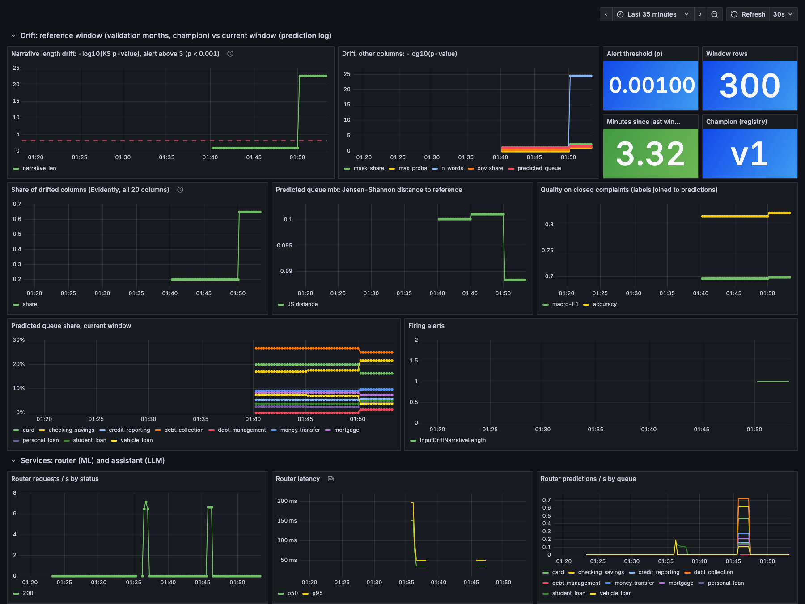
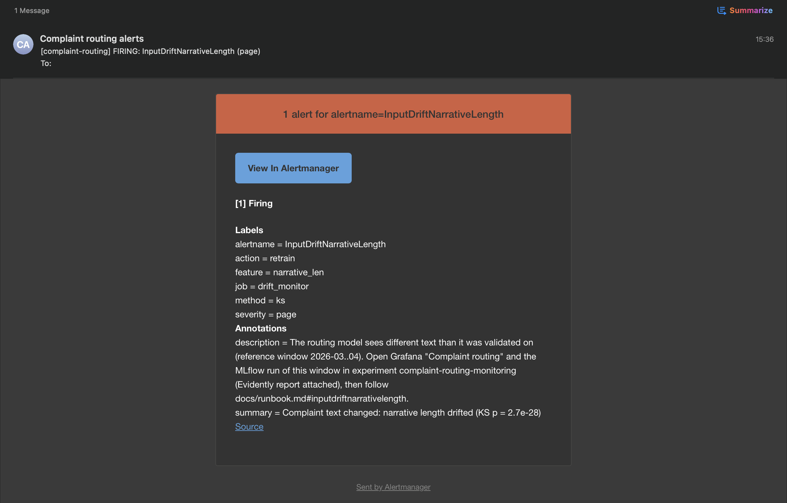

# Complaint routing — keeping a text classifier up to date

A consumer-finance complaint intake service has to send every free-text complaint to the right product review queue, and misrouted complaints wait in the wrong queue while the 15-day response clock runs.
The data behind it moves: the CFPB product taxonomy changed in 2017 and 2023–2024, credit reporting grew from about 20 % to about 90 % of complaints, and on 2026-08-14 the CFPB stopped publishing complaint narratives.
This project builds a system that classifies each complaint narrative into a routing queue at intake, trained on monthly batches of CFPB complaints replayed in time order.
A new model reaches production only after it beats the current one on the most recent held-out months, and drift in language, queue mix and upstream schema is monitored before labels arrive 15–60 days later.
The design is in [docs/design.md](docs/design.md); the course builds it over five labs (pipeline, LLM assistant, serving and monitoring, agent). Lab 4 brings the whole system up with one command: `make k8s-up` ([Lab 4](#lab-4)).

## Quick start

```bash
make setup   # pinned environment (uv), pre-commit hook, local .env from .env.example
make lint    # ruff, the same check CI runs on every push
make test    # unit tests of the cleaning rules, the quality gate and the point-in-time feature
make up      # PostgreSQL 16, MinIO, MLflow 3.16.1, Airflow 3.3.1 (docker compose)
```

| Service | URL (localhost only) | What it holds |
|---|---|---|
| Airflow 3.3.1, LocalExecutor | <http://localhost:8080> | DAG `complaints_etl` (no login: local simple auth manager) |
| MLflow 3.16.1 | <http://localhost:5050> | runs (PostgreSQL db `mlflow`), artifacts (MinIO bucket `mlflow`), registry |
| MinIO (`pgsty/silo:RELEASE.2026-09-16T00-00-00Z`) | API <http://localhost:9310>, console <http://localhost:9311> | bucket `dvc` (DVC remote), bucket `mlflow` |
| PostgreSQL 16 | `localhost:5433` | databases `airflow`, `mlflow`, `warehouse` (schemas `raw`, `dwh`, `features`, `feast_online`) |

Credentials live in `.env` (copied from `.env.example`, never committed). The Makefile exports them, so every command below works as written.

## Lab 2

### 1. Raw data, versioned with DVC

- **Source:** the CFPB Consumer Complaint Database narratives archive (FOIA reading room), 18 ZIP exports covering 2022-01 → 2026-07, 1.1 GB zipped, downloaded on 2026-10-24.
- **Sample (the archive is far above 200 MB):** for each month, take the complaints that have a published narrative, drop duplicate `Complaint ID`s, sort by `Complaint ID`, and draw 1,500 rows with `pandas.DataFrame.sample(random_state=YYYYMM)`. Columns are kept exactly as delivered. 55 files `data/raw/complaints_YYYY-MM.parquet`, 82,500 rows. Code: [`ingest.py`](src/complaint_routing/ingest.py).
- **Remote:** S3-compatible MinIO, `s3://dvc/complaint-routing` at `http://localhost:9310`. The remote config is committed ([`.dvc/config`](.dvc/config)); the keys come from `AWS_ACCESS_KEY_ID` / `AWS_SECRET_ACCESS_KEY` in `.env`.

Retrieve the data on a clean clone:

```bash
make setup && make up && make data-pull
uv run dvc status data/raw.dvc      # -> "Data and pipelines are up to date."
```

What arrives must match [`data/raw.dvc`](data/raw.dvc): **md5 `835e7d9b012a06bf4e2bddb624fdaf4f.dir`, 55 files, 26,111,493 bytes**. This md5 is the data version every pipeline row and every MLflow run carries.

The remote is a container, so on a different machine its bucket starts empty. Then rebuild the files from the public archive and seed your remote; the build is deterministic (two builds gave identical md5 for all 55 files), and `--verify` runs `dvc status` against the committed hash:

```bash
make data-rebuild && make data-push
```

### 2. ETL pipeline: `complaints_etl`

[`dags/complaints_etl.py`](dags/complaints_etl.py): `extract → validate → transform → load → build_features → quality_check`.


- **The batch is the data interval, never the clock.** Airflow 3 no longer creates intervals for `@monthly` (start == end), so the DAG declares `schedule=CronDataIntervalTimetable("@monthly", timezone="UTC")`: a run for logical date 2026-05-01 has the interval [2026-05-01, 2026-06-01) and processes month `2026-05`. A manual run has no interval in Airflow 3, so it must pass `{"month": "YYYY-MM"}` in the conf, or it fails with that message.
- **Run a specific interval:** `make etl-month MONTH=2026-05` (an Airflow backfill of exactly that interval; reruns it even if it succeeded). All months in order: `make etl-backfill` (55 runs, `max_active_runs=1`, because the features of month M read months M-5..M-1).
- **Layers in PostgreSQL `warehouse`:** `raw.complaints` (as delivered + `data_version`), `dwh.complaints` (typed, cleaned, mapped to a queue), `features.complaint_features`.

**Idempotency.** `load` and `build_features` delete the batch month and insert it again in one transaction ([`warehouse.replace_month`](src/complaint_routing/warehouse.py)). The same interval, run twice:

```text
### run 1: make etl-month MONTH=2026-05
backfill__2026-06-01T00:00:00+00:00|success|2026-05-01 00:00:00+00|2026-06-01 00:00:00+00
  layer   | count
----------+-------
 raw      |  1500
 dwh      |  1411
 features |  1411

### run 2: make etl-month MONTH=2026-05
backfill__2026-06-01T00:00:00+00:00|success|2026-05-01 00:00:00+00|2026-06-01 00:00:00+00
  layer   | count
----------+-------
 raw      |  1500
 dwh      |  1411
 features |  1411
```

The whole warehouse stays at 82,500 raw / 71,419 dwh / 71,419 feature rows after both runs. 1500 → 1411: `transform` removed 89 duplicate narratives (the same text filed more than once) in that month.

**Quality gate.** `validate` checks the raw batch against its contract before anything is written: schema (16 columns), ≥ 500 rows, ≤ 5 % null narratives, no product missing from [`config/queue_mapping.csv`](config/queue_mapping.csv), every `Date received` inside the batch month, no duplicate ids, and not the same file as the previous month (stale partition). `quality_check` checks the warehouse after the load: rows equal to what `transform` produced, features for every row, no row outside the month, one `feature_version`.

How it was shown to fail: `make bad-batch` writes [a broken copy of 2026-05](src/complaint_routing/fixtures.py) (300 narratives set to null, 50 rows with the product `Crypto lending`, 100 rows dated 2026-04-30) and triggers the DAG on it. `validate` fails on all three, the downstream tasks never run, and the 2026-05 counts above stay 1500 / 1411 / 1411.


### 3. Feature table and where each feature comes from at serving time

`build_features` fills `features.complaint_features` (one row per complaint, `event_timestamp` = date received, column `feature_version = 'v1'`) with **`company_queue_mix`**: the share of each of the 10 queues among the company's complaints received in [d − 150 days, d − 60 days), plus their count `mix_n`. The 60-day lag is the label delay: a complaint's final queue is known only when it closes. The serving-time source of every feature is the table in [design 5.3](docs/design.md#53-techniques). Training builds exactly the same table from the DVC files; checked: all 71,419 rows match the warehouse, max absolute difference of the mix features 0.0.

**Feast (optional point).** [`feature_repo/`](feature_repo) has its own environment (Feast 0.66 needs pandas < 3). Entity `company`, feature view `company_queue_mix`, offline store = the PostgreSQL table above, online store = schema `feast_online`.

```bash
make feast-apply && make feast-demo
```

```text
two feature rows of CAPITAL ONE FINANCIAL CORPORATION:
event_timestamp  mix_card  mix_checking_savings  mix_n
     2024-03-02  0.453333              0.146667     75
     2024-03-05  0.460526              0.144737     76

get_historical_features at 2024-03-03 12:00:00 (between the two rows):
                          company     event_timestamp  mix_card  mix_checking_savings  mix_n
CAPITAL ONE FINANCIAL CORPORATION 2024-03-03 12:00:00  0.453333              0.146667     75

OK: Feast returned the earlier row; the later one is after the entity timestamp.
```

`make feast-materialize` loads the latest row per company into the online store (19,052 rows) for the Lab 4 service.

### 4. Baselines and model on a time split

Train 2022-01 → 2026-02 (64,269 rows), validation 2026-03 → 04 (2,856), test 2026-05 → 07 (4,294); why not a random split: [design 5.4](docs/design.md#54-experimentation-and-validation). `make train`.

| Test 2026-05 → 07 | macro-F1 | accuracy | min recall over queues | accuracy re-weighted to the full intake mix |
|---|---|---|---|---|
| Majority queue (always `credit_reporting`) | 0.008 | 0.042 | 0.000 | **0.914** |
| Keyword rules, fallback to majority | 0.524 | 0.523 | 0.186 | 0.764 |
| **TF-IDF + one-hot + company mix → logistic regression** | **0.776** | **0.830** | 0.270 (`debt_management`) | 0.869 |

The trained model beats both rules on the metric the design optimizes (macro-F1). On the last column the majority rule wins: 91.4 % of all complaints in the test months are credit reporting, so "always credit reporting" is right 91 % of the time and routes nothing else. That is why accuracy is not a target ([design 3](docs/design.md#3-success-metrics)). Every queue except `debt_management` (37 test rows) has recall ≥ 0.71; that one queue misses the 0.60 recall target.

### 5. Experiment tracking, registry and reproduction

MLflow runs as a server with a PostgreSQL backend store and MinIO artifacts (`docker compose`). Every run logs its parameters, metrics and tags `data_version` (DVC md5 of `data/raw`), `git_commit`, `git_dirty`, `feature_version`, `mapping_version`. The candidate is registered as **`complaint-router` version 1**, alias **`champion`** (Lab 4 loads `models:/complaint-router@champion`), tagged with both lineage identifiers:


One command reproduces the champion:

```bash
make reproduce
```

It reads `git_commit` and `data_version` from the registered version, checks the commit out into a temporary git worktree, `dvc pull`s that commit's data from the remote, trains there with the logged parameters in an environment built from that commit's `uv.lock`, and compares test macro-F1. **Tolerance: ±0.005 macro-F1**; it covers BLAS/thread scheduling differences between machines, while the data, code, environment and seed are fixed. Output:

```text
$ git worktree add --detach /var/folders/.../repro-2ys05gmt 4a2c1f3fb63aa9fdea78ecf2ca5fa49b0041c05c
$ uv run --frozen dvc remote modify --local minio endpointurl http://localhost:9310
$ uv run --frozen dvc pull data/raw.dvc
$ uv run --frozen python -m complaint_routing.train --no-register --only-candidate ... --c 4.0 --max-features 100000 --min-df 3 --seed 42
$ git worktree remove --force /var/folders/.../repro-2ys05gmt

test_macro_f1: registered 0.7762, reproduced 0.7762 (run bb8664305a5c42f7a10608672e2ed3e7)
|diff| 0.0000 <= tolerance 0.005 -> REPRODUCED
```

The remote address is taken from today's `.dvc/config`, the data hash from the commit: the remote moved from port 9010 to 9310 after version 1 was trained, and the data it pulls is still identified by the same md5.

### Hardware and timing

MacBook Pro M1 Pro, 16 GB, Docker Desktop 28.3.2 (8 GB for containers). Raw build 1.5 min; one DAG run ≈ 6 s, the 55-month backfill ≈ 7 min; training ≈ 8 min on CPU; `make reproduce` ≈ 9 min (it also builds a fresh environment).

## Lab 3

The LLM component has two jobs ([design 5.1](docs/design.md#51-problem-statement)): an **LLM baseline for the routing task itself** (zero-shot queue prediction, scored with the Lab 2 metric next to the Lab 2 runs) and an **analyst assistant** that answers questions about the rules behind a complaint from the CFPB's own consumer guidance, with citations. Every setting is in [`config/llm.yaml`](config/llm.yaml); every prompt is a file in [`prompts/`](prompts) whose sha256 is logged on every run.

```bash
make llm-image      # once: build the vLLM 0.30.0 CPU image from source (1.5–2 h on an M1 Pro)
docker compose stop airflow   # the 8 GB Docker VM cannot hold Airflow and vLLM at once
make llm-up         # vLLM OpenAI-compatible server on localhost:8000, model from config/llm.yaml
make rag-index      # corpus -> chunks -> embeddings -> pgvector; prints the document count
make rag-ask Q="Can a debt collector tell my employer about my debt?"
make llm-baseline   # zero-shot routing on 300 test complaints, logged in experiment complaint-routing
make rag-eval       # retrieval + answer metrics on 57 questions, experiment complaint-assistant-rag
make rag-sweep PARAM=retrieval.chunk_size VALUES=60,120,240
```

| Service | URL (localhost only) | What it holds |
|---|---|---|
| vLLM 0.30.0 (CPU, image `vllm-cpu-arm64:0.30.0`) | <http://localhost:8000/v1> | `Qwen/Qwen2.5-0.5B-Instruct`, fp16, OpenAI-compatible API |
| PostgreSQL 16 + pgvector 0.8.7 (`pgvector/pgvector:0.8.7-pg16-trixie`) | `localhost:5433` | schema `rag` in database `warehouse`: `rag.indexes`, `rag.chunks` |

The PostgreSQL image changed from `postgres:16` to the pgvector build of the same major version and the same Debian release, so the Lab 2 volume is reused as is (82,500 raw rows still there after the switch).

### 1. Corpus

- **Ask CFPB**, the CFPB's consumer Q&A (consumerfinance.gov/ask-cfpb): every English answer page listed in the site's `sitemap.xml`, fetched on 2026-11-07. One page = one document, id `ask-<n>` from the URL. Categories mirror the routing queues (mortgages 191 pages, bank accounts 84, credit reports 55, auto loans 54, student loans 53, credit cards 51, debt collection 47, prepaid cards 33, fraud and scams 28, payday loans 19, reverse mortgages 18, money transfers 10, general 13).
- **656 documents, 211,230 words** (median 261 words per page); 17 pages whose answer is shorter than 200 characters are dropped. Public: a US federal government work.
- The snapshot is committed, [`data/corpus/ask_cfpb.jsonl`](data/corpus/ask_cfpb.jsonl) (1.5 MB), **md5 `f9e1907f4bfe9d6b98e28f0678efe7ad`**; this md5 is the corpus version on every run. `make corpus` re-fetches the live site, which produces a new version ([`corpus.py`](src/complaint_routing/llm/corpus.py)).

### 2. Retrieval pipeline

Diagram: [design 6.1, Retrieval pipeline](docs/design.md#retrieval-pipeline-lab-3). Chunk size, overlap, embedding model and top-k live only in `config/llm.yaml`. The index rows are keyed by an **index version** = hash(corpus md5, chunk size, overlap, embedding model), so the query path refuses to run against an index that does not match the config and the corpus, and sweeps build their own index versions next to the served one.

```text
$ make rag-index
corpus data/corpus/ask_cfpb.jsonl (md5 f9e1907f4bfe9d6b98e28f0678efe7ad), chunk_size 120, overlap 20, embedding sentence-transformers/all-MiniLM-L6-v2
index 6c1f3b1fc70f: 656 documents, 2300 chunks -> rag.chunks
```

**The index has 656 documents and 2,300 chunks** (57 s on the laptop CPU, embeddings included).

The query path end to end (`make rag-ask`): distance, chunk id and title of the top 5, then the answer, tokens, latency and the answer prompt's hash.

```text
$ make rag-ask Q="Can a debt collector tell my employer about my debt?"
  0.178  ask-332#3      Can debt collectors tell other people, like family, friends, or my employer, about my debt?
  0.252  ask-1411#6     How do I get a debt collector to stop calling or contacting me?
  0.267  ask-1699#3     How do I tell if a debt collector is legitimate or a scam?
  0.267  ask-1699#0     How do I tell if a debt collector is legitimate or a scam?
  0.271  ask-332#0      Can debt collectors tell other people, like family, friends, or my employer, about my debt?

Yes, a debt collector can tell your employer about your debt. If a debt collector calls your employer, you might want to talk to the person who took the call to find out what the debt collector said. A debt collector may not tell your employer that you owe a debt. If the debt collector has told your employer that you owe a debt, you may want to speak to an attorney about your rights.

[851 tokens in, 83 out, 7.2 s, prompt e749481e4147]
```

Retrieval is right (the relevant page is first), the answer opens with the opposite of what the page says and then corrects itself, and it cites nothing. This is the failure pattern the evaluation below measures.

### 3. LLM baseline for routing (same task, same metric)

`make llm-baseline` sends 300 test complaints (seeded random sample of 2026-05 → 07, natural queue mix) to the LLM with the prompt in [`prompts/classify_v2.txt`](prompts/classify_v2.txt), and scores the champion on exactly the same rows. Both runs are in the Lab 2 experiment `complaint-routing`, with the same metric names as the Lab 2 runs, so they sort side by side in the MLflow UI. All runs below: commit `369aeba`, `git_dirty=false`.

| Run (experiment `complaint-routing`) | prompt hash | macro-F1 | accuracy | min recall | unparsed | p50 / p95 latency |
|---|---|---|---|---|---|---|
| `llm-zero-shot-Qwen2.5-0.5B-Instruct`, prompt v1 (`1974752…`) | `4876df1eeccd` | 0.040 | 0.083 | 0.000 | 0.7 % | 0.93 / 1.43 s |
| `llm-zero-shot-Qwen2.5-0.5B-Instruct`, **prompt v2** (`eea0fc8…`) | `860affc491b5` | **0.339** | 0.330 | 0.000 | 5.7 % | 1.02 / 1.52 s |
| `champion-on-llm-sample` (`complaint-router@champion`, same 300 rows) | — | **0.829** | 0.850 | 0.588 | — | (ms, in process) |

- **Prompt v1 collapsed:** the 0.5B model answered `credit_reporting` for 273 of 300 complaints. v2 puts the complaint first and the options after it, with the examples of each product next to its name; macro-F1 went from 0.04 to 0.34. v1 is a file in the repository with its own hash: its run stays reproducible (every rerun of v1 gave 0.0405 again, at temperature 0), and `config/llm.yaml` now points to v2.
- **The decision this comparison informs:** a zero-shot 0.5B LLM is not a replacement for the trained classifier (0.34 vs 0.83 macro-F1 on the same rows) and not even a fallback for a new queue. The routing service stays on the champion; the LLM's job in this system is the assistant below.
- v1's "accuracy re-weighted to the intake mix" is 0.919, only 1 pp below the champion's 0.928: a model that almost always says credit reporting looks good on that number, which is why it is not a target (design 3).

### 4. Evaluation set

[`eval/rag_questions.jsonl`](eval/rag_questions.jsonl): **57 questions** over all 10 queues, each with 1–2 relevant document ids and a reference answer. They were **generated with an LLM (Claude) from the corpus, then read and corrected against the documents**. No question quotes its document: the questions describe the complaint situation ("the agency told her boss…") instead of using the page title or product names; a check for 3-word phrases shared with the document title found only generic ones ("is there a"). Relevance is per document, so the chunk-size sweep is scored against the same labels. Details: [design 5.4](docs/design.md#54-experimentation-and-validation).

### 5. Retrieval and answer metrics, one parameter at a time

`make rag-sweep PARAM=retrieval.chunk_size VALUES=120,60,240`; overlap (20 words), embedding model (`all-MiniLM-L6-v2`), top-k (5), LLM and prompts unchanged. Experiment `complaint-assistant-rag`, commit `369aeba`.

| chunk size (words) | chunks | hit rate@1 | hit rate@5 | hit rate@10 | MRR@10 | **answer correct (hand rubric, 19 q)** | answer correct (LLM judge v1, 57 q) | judge agrees with hand | tokens in / out per answer | p50 / p95 latency | run |
|---|---|---|---|---|---|---|---|---|---|---|---|
| 60 | 5,275 | 0.351 | 0.649 | 0.807 | 0.507 | **0.421** (8/19) | 0.807 | 0.53 | 597 / 90 | 4.4 / 11.2 s | `90ba3a1f` |
| **120 (served)** | 2,300 | **0.491** | **0.684** | 0.807 | 0.571 | 0.263 (5/19) | 0.842 | 0.37 | 854 / 85 | 5.1 / 13.5 s | `e453e367` |
| 240 | 1,238 | 0.491 | 0.667 | **0.842** | **0.572** | 0.211 (4/19) | 0.842 | 0.26 | 1,137 / 75 | 4.9 / 11.4 s | `24ac1bd2` |

A second parameter, the embedding model (retrieval only, chunk size 120; `make rag-sweep PARAM=retrieval.embedding_model VALUES=…`):

| embedding model | hit rate@1 | hit rate@5 | hit rate@10 | MRR@10 | run |
|---|---|---|---|---|---|
| **`sentence-transformers/all-MiniLM-L6-v2` (served)** | **0.491** | 0.684 | 0.807 | **0.571** | `569f6e5e` |
| `sentence-transformers/multi-qa-MiniLM-L6-cos-v1` | 0.404 | 0.649 | 0.772 | 0.514 | `933d9492` |
| `BAAI/bge-small-en-v1.5` | 0.421 | **0.772** | **0.860** | 0.559 | `7bf09278` |

What the tables say:
- **Chunk size.** 60-word chunks split an answer into pieces that each match the question less well: hit rate@1 drops from 0.49 to 0.35. Going from 120 to 240 words changes little for retrieval (hit@10 +0.035, the same MRR) but makes every prompt 33 % longer. 120 stays the served value.
- **The answers move the other way.** The small model answers better from shorter context (8/19 correct at 60 words vs 5/19 at 120 and 4/19 at 240): with 1,100 tokens of excerpts it more often copies an unrelated passage. On 19 graded questions the difference is within noise (±0.11 standard error), so the next step is to hand-grade all 57 before changing the served value.
- **Embedding model.** `bge-small-en-v1.5` finds the right document somewhere in the top 5 more often (0.77 vs 0.68) but ranks it first less often; with top-k = 5 it would give the LLM the right page for 5 more of the 57 questions. It is the first candidate for the next sweep (with its query prefix).
- **Hit rate@5 of 0.68 with MRR 0.57**: when the retriever finds the page it is usually first or second. Of the 18 misses at top 5, some are unlabelled pages that answer the question too: q46 (servicer ignored an error notice) retrieves "How do I dispute an error or request information about my mortgage?" first, q35 (is a prepaid balance insured) retrieves the page on registering a prepaid card, which is the condition for FDIC insurance. So the labels undercount hit rate somewhat; adding second relevant documents is a change to the evaluation set, i.e. a new `eval_set_md5`. Others are real misses: q40 (when private mortgage insurance ends) retrieves a reverse-mortgage page.

**The answer metric is a hand rubric, because the LLM judge does not work at 0.5B.**
- The rubric: an answer is correct if a reader would learn the key fact of the reference answer, without a contradiction. Applied to every third question (19 per configuration), stored in [`eval/hand_grades.csv`](eval/hand_grades.csv) with a one-line reason for each wrong answer. Each grade is keyed by the sha256 of the answer text, so `evaluate` counts it only for that exact answer; the final runs regenerated identical answers (temperature 0) and matched all 19 grades.
- **Judge v1** ([`prompts/judge_v1.txt`](prompts/judge_v1.txt), hash `7b1a3fbaa9d8`) says YES to almost everything: it agrees with the hand grades on 22 of 57 graded answers (39 %), with 33 false YES and 2 false NO. A typical false YES: "Yes, a debt collector can threaten to arrest someone" graded YES against the reference "a collector cannot threaten arrest".
- **Judge v2** ([`prompts/judge_v2.txt`](prompts/judge_v2.txt), hash `025186aeb8dc`, stricter, two worked examples) says NO to all 57 answers (run `8a29e7fa`). With identical answers, `answer_correct` went from 0.84 to 0.00 by editing the judge prompt alone — the reason the judge prompt is versioned and hashed like every other prompt.
- Also measured on every run: citation rate 0–3.5 % (the 0.5B model ignores the "cite [ask-id]" instruction), so `cited_outside_retrieved_rate` (0 %) is not yet informative; refusal rate 0 % except one refusal at chunk size 60 when the right page was at rank 1.

### 6. Cost and latency; local inference vs an API

Measured on the runs above (MacBook Pro M1 Pro, 8 cores, 16 GB; Docker VM 8 CPUs / 8 GB; vLLM container 4.9 GB resident, `Qwen2.5-0.5B-Instruct` in fp16, no quantization, no GPU):

| Call | calls per run | tokens in / out per call | p50 | p95 | cold first call | compute per call |
|---|---|---|---|---|---|---|
| Assistant answer (chunk 120, top-5) | 57 | 854 / 85 | 5.1 s | 13.5 s | 2.8 s | 5.9 s |
| Judge | 57 | 240 / 2 | 0.61 s | 0.98 s | 0.62 s | 0.65 s |
| Routing (prompt v2) | 300 | 418 / 3.4 | 1.02 s | 1.52 s | 0.98 s | 1.05 s |

- **Money:** none beyond the laptop; the cost is the local resource: about 6 s of the 8-core Docker VM per answered question and 4.9 GB of its memory while the server runs. A whole 57-question evaluation takes 6 min of LLM compute plus 37 s of judging.
- **Cold prompt:** each run starts right after `docker compose restart vllm`, so its first call has an empty prefix cache (`llm_latency_first_s`). It is not slower than the median here, because every answer prompt carries different excerpts: only the ~100-token instruction prefix can be cached.
- **The tail** (p95 13.5 s vs p50 5.1 s) comes from output length: the run produced 4,837 output tokens in 338 s including prefill (about 14 tokens/s), and a few answers run to the 256-token limit (numbered step lists). Prompt length matters less: 240-word chunks add 280 input tokens per answer and do not move p50.
- **Why local and not an API** ([design 6.3, 6.7, 7.1](docs/design.md#67-cost)): the analyst questions and, in the routing baseline, complaint narratives never leave the machine; the model behind the name cannot change under us, so runs stay reproducible; no key to protect. What it costs us: answer quality (5 of 19 correct, a judge that cannot judge), 5–13 s per answer, and 4.9 GB of an 8 GB Docker VM — the first vLLM image build with 4 parallel jobs ran the VM out of memory and killed Airflow and MLflow (exit 137), so `make llm-image` now uses 2 jobs. Moving to an API is three lines of `config/llm.yaml` and a key in `.env`.

### Hardware and timing (Lab 3)

vLLM image build from source: about 1.5–2 h in total on the M1 Pro (ARM Compute Library, oneDNN and vLLM's CPU kernels), 5.2 GB image. Index build: 57 s. A 57-question evaluation with judge: about 7 min; the 300-complaint routing baseline: about 6 min. Airflow is stopped while vLLM runs (`docker compose stop airflow`): the Docker VM does not hold Airflow, MLflow, PostgreSQL and vLLM at once.

## Lab 4

The router (Lab 2 model) and the assistant (Lab 3 LLM component) run as two containers on Minikube, each with a health contract, next to the MLflow tracking server in the cluster. The router loads its model from the registry by alias. A CronJob compares what the router has served with what the model was validated on, Prometheus and Grafana show it, and a deliberate shift crosses the threshold and reaches a person; the same alert starts a retraining run. Topology and loop: [design 6.1](docs/design.md#deployment-lab-4-as-built); thresholds: [design 6.6](docs/design.md#66-monitoring-and-alarms).

```bash
make k8s-up          # ONE command: storage, Minikube, images (tag = commit), every workload, smoke request
make k8s-forward     # 127.0.0.1 access to the cluster's Services (below)
make replay          # 300 held-out complaints through POST /predict, labels delivered
make replay-shift    # the same with the documented shift
make drift-now       # run the drift CronJob once, now
make promote VERSION=2   # move @champion, restart the router (rollback: the previous version)
```

| Service (namespace `complaint-routing`) | Kubernetes objects | Host access after `make k8s-forward` |
|---|---|---|
| router, the ML service: `POST /predict`, `/health/ready`, `/health/live`, `/metrics` | Deployment + Service, readiness + liveness | <http://localhost:8081> |
| assistant, the LLM service: `POST /ask`, same health and metrics | Deployment + Service, readiness + liveness | <http://localhost:8082> |
| MLflow 3.16.1 tracking server + registry | Deployment + Service `mlflow:5000` | <http://localhost:5051> |
| Grafana 12.1.0, dashboard "Complaint routing" | Deployment + Service | <http://localhost:3000> |
| Prometheus 3.5.0, alert rules | Deployment + Service | <http://localhost:9090> |
| Alertmanager 0.28.1 (e-mail) / Pushgateway 1.11.1 | Deployment + Service each | <http://localhost:9093> / <http://localhost:9091> |
| drift job | CronJob `drift-monitor`, every 5 min | — |
| retraining (stretch) | Deployment `retrain-trigger` + suspended CronJob `retrain` + RBAC | — |
| configuration | ConfigMaps `routing-config`, `llm-config` (= `config/llm.yaml`), `prometheus-config`, `grafana-*`; Secrets `complaint-routing-secrets`, `alertmanager-config` (from `.env`) | — |

PostgreSQL (features, prediction log, pgvector, MLflow's backend store), MinIO (MLflow artifacts) and vLLM stay in docker compose next to the cluster, on the same Docker VM; pods reach them as `host.minikube.internal`. Docker Desktop needs **12 GB** for this lab (measured in [8](#8-performance-and-resources)); Airflow is not needed and stays stopped.

### 1. One command brings it up

`make k8s-up` ([`scripts/k8s-up.sh`](scripts/k8s-up.sh)) runs, in order: `.env` and `uv sync` → compose storage + vLLM → preflight ([`scripts/preflight.py`](scripts/preflight.py): `complaint-router@champion` exists, its reference window exists (built if not), the feature table is filled, the retrieval index exists (built if not)) → `minikube start` (profile `complaint-routing`, Kubernetes v1.30.0, 4 GB, 2 CPUs) → images built inside Minikube → Secret and ConfigMaps from `.env` and the repository → all manifests in [`k8s/`](k8s) → `kubectl rollout status` for every Deployment → a smoke request through the Service from a pod inside the cluster. It is idempotent: a second run reuses the cluster and the images of the same commit.

**How long it takes**, measured on a clean clone (`git clone` into a new directory, no `.env`, the Minikube profile deleted first, so every image is built from scratch), commit `66c2438`: **11 min 16 s**. The three longest steps: building the three images inside Minikube (8 min 49 s; the assistant image installs CPU torch and downloads the embedding model, and the three builds run one after another, so they could run in parallel or come from a registry cache), waiting for the Deployments to become ready (89 s; the assistant loads the embedding model and checks vLLM, the router downloads its model from the registry), and `minikube start` (25 s with the Kubernetes images already cached by an earlier start; ~4 min on a machine that has never pulled them). A second `make k8s-up` with the cluster and images in place takes **14 s**. The first clean-clone run failed in the preflight: the Makefile reads `.env` before the script creates it, so the database URL it exported had an empty user and password; the script now builds it after `.env` exists (commit `66c2438`), and the run above is the one after the fix.

```text
$ git clone <repo> clean-clone && cd clean-clone && time make k8s-up
[   0s] == 0/8 local environment (.env, uv)
[   2s] == 1/8 storage next to the cluster: PostgreSQL, MinIO, MLflow (docker compose); vLLM
[   4s] == 2/8 preflight: registry, reference window, features, retrieval index
[  26s] == 3/8 Minikube (complaint-routing: Kubernetes v1.30.0, docker driver, 4 GB, 2 CPUs)
[  51s] == 4/8 images, tag = commit 66c2438cc908, built inside Minikube
[ 580s] == 5/8 namespace, Secret (from .env), ConfigMaps
[ 581s] == 6/8 workloads: MLflow, router, assistant, monitoring, drift CronJob
[ 583s] == 7/8 waiting for every Deployment to be ready
[ 672s] == 8/8 smoke request: POST http://router/predict from inside the cluster
ready: True, image 66c2438cc908dd060c615441b7ddba7e72414c7c
POST http://router/predict -> queue vehicle_loan (top 3 [('vehicle_loan', 0.5317), ('personal_loan', 0.3914), ('debt_collection', 0.0306)]), complaint-router@champion = v1, 43 ms
[ 675s] == done in 675 s. Host access: make k8s-forward
make k8s-up  8.60s user 7.85s system 2% cpu 11:15.82 total
```

Prerequisites, from Labs 2–3 and checked by the preflight: the registry has `complaint-router@champion` (`make data-pull && make train`), the warehouse has the feature table (`make etl-backfill`), and the vLLM image is built (`make llm-image`, 1.5–2 h once; without it everything comes up except the assistant, which stays not ready and says why).

### 2. Containers: two services, tag = commit

One [Dockerfile](docker/service/Dockerfile), three targets; each installs the project plus only its dependency group from `uv.lock` (`--frozen`): `router` (FastAPI, the model's libraries), `assistant` (+ sentence-transformers, torch CPU, the embedding model baked in, the corpus file whose md5 is part of the index version), `monitor` (Evidently; the drift job, the trigger and the retraining job). No routing model is in any image. The build command, as the bring-up runs it:

```bash
minikube -p complaint-routing image build -t complaint-routing/router:$(git rev-parse --short=12 HEAD) \
  -f docker/service/Dockerfile --build-opt=target=router --build-opt=build-arg=GIT_COMMIT=$(git rev-parse HEAD) .
```

The tag is the commit (`-dirty` is appended if the working tree has uncommitted changes, so a dirty image never carries a clean commit); the full commit is also the image label `org.opencontainers.image.revision`, the `GIT_COMMIT` variable, the `image_commit` of every `/predict` response, every prediction-log row and the `router_model_info` metric. From a wrong prediction: its row in `serving.predictions` → `model_version` (registry → `git_commit` and `data_version` tags of that version) and `image_commit` (the serving code).

Health contract (both services): `/health/ready` is 503 with what it still waits for until the model, the features and the prediction log (router) or the embedding model, the index version and the LLM server (assistant) are usable; the readiness probe uses it, so the Service sends no traffic before. `/health/live` only says the process answers; the liveness probe restarts a hung process, not a missing model (a restart cannot create one).

All ready, after `make k8s-up` at commit `ce2bf91`:

```text
$ kubectl -n complaint-routing get pods,svc,cronjob
NAME                                   READY   STATUS      RESTARTS   AGE
pod/alertmanager-6879f95795-vr9jc      1/1     Running     0          11m
pod/assistant-86c47c48dc-mg7wz         1/1     Running     0          51s
pod/drift-manual-d7fd6                 0/1     Completed   0          9m55s
pod/drift-monitor-29921725-nbhb9       0/1     Completed   0          8m8s
pod/drift-monitor-29921730-fn5hp       0/1     Completed   0          3m8s
pod/grafana-74c6c4f7bb-qbv8z           1/1     Running     0          11m
pod/mlflow-7b947c6db5-cgf2z            1/1     Running     0          11m
pod/prometheus-64b5dff557-5zxtj        1/1     Running     0          11m
pod/pushgateway-845fb58698-cnqv6       1/1     Running     0          11m
pod/retrain-trigger-8559b5b8fd-vbj6z   1/1     Running     0          50s
pod/router-85fcbd547c-lq8jz            1/1     Running     0          51s

NAME                      TYPE        CLUSTER-IP       EXTERNAL-IP   PORT(S)    AGE
service/alertmanager      ClusterIP   10.101.179.88    <none>        9093/TCP   11m
service/assistant         ClusterIP   10.98.179.114    <none>        80/TCP     11m
service/grafana           ClusterIP   10.96.136.6      <none>        3000/TCP   11m
service/mlflow            ClusterIP   10.108.230.185   <none>        5000/TCP   11m
service/prometheus        ClusterIP   10.109.193.222   <none>        9090/TCP   11m
service/pushgateway       ClusterIP   10.103.159.64    <none>        9091/TCP   11m
service/retrain-trigger   ClusterIP   10.99.105.167    <none>        8080/TCP   11m
service/router            ClusterIP   10.99.255.178    <none>        80/TCP     11m

NAME                          SCHEDULE      TIMEZONE   SUSPEND   ACTIVE   LAST SCHEDULE   AGE
cronjob.batch/drift-monitor   */5 * * * *   <none>     False     0        3m8s            11m
cronjob.batch/retrain         0 0 1 1 *     <none>     True      0        <none>          11m

$ kubectl -n complaint-routing get deploy -o custom-columns=NAME:.metadata.name,IMAGE:.spec.template.spec.containers[0].image
NAME              IMAGE
alertmanager      prom/alertmanager:v0.28.1
assistant         complaint-routing/assistant:ce2bf910ba24
grafana           grafana/grafana:12.1.0
mlflow            complaint-routing/mlflow:3.16.1
prometheus        prom/prometheus:v3.5.0
pushgateway       prom/pushgateway:v1.11.1
retrain-trigger   complaint-routing/monitor:ce2bf910ba24
router            complaint-routing/router:ce2bf910ba24

$ minikube -p complaint-routing image ls | grep complaint-routing/
docker.io/complaint-routing/router:ce2bf910ba24
docker.io/complaint-routing/monitor:ce2bf910ba24
docker.io/complaint-routing/monitor:3d6b5f5942e5-dirty
docker.io/complaint-routing/mlflow:3.16.1
docker.io/complaint-routing/assistant:ce2bf910ba24
```

### 3. The registry by alias: missing model, promotion, rollback

**Missing model.** The router is pointed at an alias that does not exist; the new pod starts, never becomes ready and receives no traffic, while the old one keeps serving (the rolling update cannot complete), and liveness does not restart it:

```text
$ kubectl -n complaint-routing set env deployment/router MODEL_ALIAS=does-not-exist
deployment.apps/router env updated

$ kubectl -n complaint-routing get pods -l app=router -o wide
NAME                      READY   STATUS    RESTARTS   AGE    IP            NODE                NOMINATED NODE   READINESS GATES
router-85fcbd547c-lq8jz   1/1     Running   0          111s   10.244.0.16   complaint-routing   <none>           <none>
router-fb6d54867-b2mff    0/1     Running   0          45s    10.244.0.20   complaint-routing   <none>           <none>

$ kubectl -n complaint-routing exec pod/router-fb6d54867-b2mff -- curl /health/ready   (python urllib)
503 {"ready":false,"waiting_for":{"model":"RestException: INVALID_PARAMETER_VALUE: Registered model alias does-not-exist not found.","features":"not loaded yet"},"model":"complaint-router@does-not-exist","model_version":null,"image_commit":"ce2bf910ba24b7cb7184be4fa5ed738dbf29633a"}

$ kubectl -n complaint-routing get endpoints router -o jsonpath=ready/notReady addresses
ready:    10.244.0.16 router-85fcbd547c-lq8jz
notReady: 10.244.0.20 router-fb6d54867-b2mff

$ kubectl -n complaint-routing describe pod/router-fb6d54867-b2mff | grep -A8 Events
  Normal   Scheduled  45s                default-scheduler  Successfully assigned complaint-routing/router-fb6d54867-b2mff to complaint-routing
  Normal   Pulled     45s                kubelet            Container image "complaint-routing/router:ce2bf910ba24" already present on machine
  Normal   Created    45s                kubelet            Created container router
  Normal   Started    45s                kubelet            Started container router
  Warning  Unhealthy  43s (x2 over 44s)  kubelet            Readiness probe failed: Get "http://10.244.0.20:8000/health/ready": dial tcp 10.244.0.20:8000: connect: connection refused
  Warning  Unhealthy  0s (x9 over 40s)   kubelet            Readiness probe failed: HTTP probe failed with statuscode: 503

$ kubectl -n complaint-routing logs pod/router-fb6d54867-b2mff | grep "not ready" | tail -2
2026-11-21 23:33:55,977 WARNING router model not ready: RestException: INVALID_PARAMETER_VALUE: Registered model alias does-not-exist not found.
2026-11-21 23:34:05,994 WARNING router model not ready: RestException: INVALID_PARAMETER_VALUE: Registered model alias does-not-exist not found.

$ kubectl -n complaint-routing rollout undo deployment/router
deployment.apps/router rolled back
Waiting for deployment "router" rollout to finish: 1 old replicas are pending termination...
deployment "router" successfully rolled out
NAME                      READY   STATUS        RESTARTS   AGE
router-85fcbd547c-lq8jz   1/1     Running       0          111s
router-fb6d54867-b2mff    0/1     Terminating   0          45s
```

**Promotion without a rebuild.** v2 was trained with the Lab 2 code (`python -m complaint_routing.train --only-candidate --alias challenger --c 2.0`, test macro-F1 0.779 vs v1's 0.776; `train.py` now also logs the reference window). `make promote VERSION=2` moves `@champion` to v2 (the version it replaces becomes `@previous`) and restarts the Deployment; the same image now answers with v2. Rollback is the same command with the previous version. (v3 is the retraining candidate of [6](#6-stretch-the-alert-starts-a-retraining-run).)

```text
$ make registry
v1   aliases=champion             run=2b8fe1ef {'git_commit': '4a2c1f3fb63aa9fdea78ecf2ca5fa49b0041c05c', 'data_version': '835e7d9b012a06bf4e2bddb624fdaf4f.dir', 'trigger': None}
v2   aliases=challenger,previous  run=a189d67b {'git_commit': 'ce2bf910ba24b7cb7184be4fa5ed738dbf29633a', 'data_version': '835e7d9b012a06bf4e2bddb624fdaf4f.dir', 'trigger': None}
v3   aliases=candidate            run=abc7d605 {'git_commit': 'ce2bf910ba24b7cb7184be4fa5ed738dbf29633a', 'data_version': '835e7d9b012a06bf4e2bddb624fdaf4f.dir', 'trigger': 'alert:InputDriftNarrativeLength'}

$ kubectl -n complaint-routing get deploy router -o jsonpath={..image}
complaint-routing/router:ce2bf910ba24
$ curl -X POST localhost:8081/predict -d {"narrative": "My student loan servicer put my loans in forbearance ..."}
{'queue': 'student_loan', 'model_name': 'complaint-router', 'model_alias': 'champion', 'model_version': '1', 'image_commit': 'ce2bf910ba24b7cb7184be4fa5ed738dbf29633a'}

$ make promote VERSION=2
complaint-router@champion: v1 -> v2 (previous = v1)
deployment.apps/router restarted
deployment "router" successfully rolled out
$ kubectl -n complaint-routing get deploy router -o jsonpath={..image}
complaint-routing/router:ce2bf910ba24
$ curl -X POST localhost:8081/predict -d {"narrative": "My student loan servicer put my loans in forbearance ..."}
{'queue': 'student_loan', 'model_name': 'complaint-router', 'model_alias': 'champion', 'model_version': '2', 'image_commit': 'ce2bf910ba24b7cb7184be4fa5ed738dbf29633a'}

$ make promote VERSION=1     # rollback: the same command with the previous version
complaint-router@champion: v2 -> v1 (previous = v2)
deployment.apps/router restarted
deployment "router" successfully rolled out
$ kubectl -n complaint-routing get deploy router -o jsonpath={..image}
complaint-routing/router:ce2bf910ba24
$ curl -X POST localhost:8081/predict -d {"narrative": "My student loan servicer put my loans in forbearance ..."}
{'queue': 'student_loan', 'model_name': 'complaint-router', 'model_alias': 'champion', 'model_version': '1', 'image_commit': 'ce2bf910ba24b7cb7184be4fa5ed738dbf29633a'}

$ make registry
v1   aliases=champion             run=2b8fe1ef {'git_commit': '4a2c1f3fb63aa9fdea78ecf2ca5fa49b0041c05c', 'data_version': '835e7d9b012a06bf4e2bddb624fdaf4f.dir', 'trigger': None}
v2   aliases=challenger,previous  run=a189d67b {'git_commit': 'ce2bf910ba24b7cb7184be4fa5ed738dbf29633a', 'data_version': '835e7d9b012a06bf4e2bddb624fdaf4f.dir', 'trigger': None}
v3   aliases=candidate            run=abc7d605 {'git_commit': 'ce2bf910ba24b7cb7184be4fa5ed738dbf29633a', 'data_version': '835e7d9b012a06bf4e2bddb624fdaf4f.dir', 'trigger': 'alert:InputDriftNarrativeLength'}
```

The assistant takes its whole configuration from the same `config/llm.yaml` as Lab 3 (ConfigMap `llm-config`; only `llm.base_url` is overridden to reach vLLM from the cluster, and that override is part of the reported `config_hash`). It reproduces the Lab 3 answer to the same question word for word, with the same retrieval (`ask-332#3` first at distance 0.178), prompt hash `e749481e4147` and index version `6c1f3b1fc70f`.

### 4. Monitoring on a schedule

- **Reference window:** the validation months 2026-03 → 04 (2,856 complaints) scored by the champion, stored as `monitoring/reference.parquet` in the champion's MLflow run; `train.py` logs it for each new version (v1 was backfilled by `make reference`). Why not the training set: [design 6.6](docs/design.md#66-monitoring-and-alarms).
- **Current window:** `serving.predictions`, written by the router for every request it serves (scrubbed narrative, form fields, the company-mix features it used, text descriptors, predicted queue, top probability, model version, image commit), last 10 minutes, at most 300 rows (seeded subsample).
- **Job:** CronJob `drift-monitor` every 5 minutes ([`drift.py`](src/complaint_routing/monitoring/drift.py)): Evidently `DataDriftPreset` on 20 columns (KS for numeric, chi-squared for categorical), Jensen–Shannon distance of the predicted queue mix, macro-F1 on predictions whose labels arrived; pushed to the Pushgateway, one MLflow run per window (experiment `complaint-routing-monitoring`, Evidently HTML report attached when the alert condition holds). The services' `/metrics` are scraped by Prometheus (request counts, latency histograms, predictions by queue, readiness, loaded version).

Dashboard after the windows below (two unshifted windows, then the shifted one; the narrative-length panel plots −log10 p, so the dashed line at 3 is p = 0.001):



### 5. A shift injected, detected, and a person alerted

**The shift** ([`shift.py`](src/complaint_routing/monitoring/shift.py)): in 30 % of the rows (seeded), the narrative is cut to its first 25 words — an intake form that starts limiting the free-text box, a covariate shift of the text. Rows: 300 held-out complaints of the test months 2026-05 → 07 (never in training or the reference), cleaned from the DVC files, sent to `POST /predict` by [`replay.py`](src/complaint_routing/monitoring/replay.py) with 4 parallel requests; the router logs them, and that log is what the job reads.

```text
$ make replay        # 23:36 UTC
300 held-out complaints (test months 2026-05..2026-07, seed 2026); shift=none: 0 rows changed (0%); median words 183, median chars 1101
{"sent": 300, "ok": 300, "errors": {}, "seconds": 3.5, "latency_p50_ms": 45.1, "latency_p95_ms": 63.8, "model_versions": {"1": 300}, "accuracy_vs_true_queue": 0.817}
labels delivered to serving.labels: 300

$ make replay-shift SEED=2027   # 23:45 UTC
300 held-out complaints (test months 2026-05..2026-07, seed 2027); shift=truncate: 95 rows changed (32%); median words 102, median chars 597
{"sent": 300, "ok": 300, "errors": {}, "seconds": 3.4, "latency_p50_ms": 42.4, "latency_p95_ms": 60.5, "model_versions": {"1": 300}, "accuracy_vs_true_queue": 0.807}
```

**Each window, as the CronJob logged it** (MLflow experiment `complaint-routing-monitoring`):

| window end (UTC) | traffic in the window | rows | KS p, narrative length | share of drifted columns (Evidently) | alert |
|---|---|---|---|---|---|
| 23:40 | unshifted batch | 302 | 0.107 | 0.20 | — |
| 23:45 | unshifted batch | 301 | 0.116 | 0.20 | — |
| **23:50** | **shifted batch** | 300 | **1.7 × 10⁻²³** | 0.65 | **`InputDriftNarrativeLength` firing** |
| 00:00 | 3,000 unshifted requests of the load test (8) | 3,000 (300 used) | 0.51 | 0.55 | resolved |

What the shift does to the columns: `n_words` p = 3·10⁻²⁵, `oov_share` 0.035, the predicted queue (chi-squared) 0.029, while the accuracy of the routed batch moved only from 0.817 to 0.807. The last row is why the alert is not on Evidently's dataset rule (share ≥ 0.5): an unshifted window crosses it.

**The threshold, in one paragraph.** The alert is `drift_feature_score{feature="narrative_len"} < 0.001` with at least 100 rows ([`rules.yml`](k8s/monitoring/rules.yml)); the consumer is the ML engineer who keeps the routing trustworthy for the intake analysts before labels arrive (15–60 days). On 60 windows of 300 unshifted held-out complaints the KS p-value of narrative length was below 0.05 in 7 (12 %), below 0.01 in 1 and below 0.001 in none; with this shift it was below 0.001 in 60 of 60 (20 % of rows cut: 59 of 60; 10 %: 21 of 60). A false alarm costs ten minutes of reading and a retraining run nobody has to promote; a missed drift of this kind costs about one point of accuracy now (83.2 % → 82.1 % over the 60 windows) and is the early form of text disappearing altogether. So 0.001: no false alarm measured, every 30 % shift caught, shifts touching ≤ 10 % of rows accepted as misses. The share-of-drifted-columns rule was rejected because the company-mix features drift between any two quarters (3 of 12 unshifted windows above 0.5). Full argument: [design 6.6](docs/design.md#66-monitoring-and-alarms).

**The alert, in Prometheus and Alertmanager** (routed to both receivers: `human` = e-mail, `retrain` = the stretch webhook):

```text
$ curl -s localhost:9090/api/v1/alerts
InputDriftNarrativeLength firing activeAt 2026-11-21T23:50:12.464576411Z value 1.717878803950513e-23

$ curl -s localhost:9093/api/v2/alerts
InputDriftNarrativeLength active startsAt 2026-11-21T23:50:12.464Z receivers ['retrain', 'human'] | Complaint text changed: narrative length drifted (KS p = 1.7e-23)
       tags.mlflow.runName  metrics.window_rows  metrics.alert_pvalue  metrics.drift_share  metrics.quality_macro_f1
0  window-2026-11-21T23:50                300.0          1.717879e-23                 0.65                  0.698836
1  window-2026-11-21T23:45                301.0          1.164622e-01                 0.20                  0.696398
2  window-2026-11-21T23:40                302.0          1.070450e-01                 0.20                  0.696398
3  window-2026-11-21T23:35                  0.0                   NaN                  NaN                       NaN
4  window-2026-11-21T23:30                  1.0                   NaN                  NaN                       NaN
5  window-2026-11-21T23:25                  1.0                   NaN                  NaN                       NaN
['drift_summary.json', 'evidently_drift_report.html']
```

**The e-mail.** Alertmanager's `human` receiver sends it through Gmail SMTP (`smtp.gmail.com:587`, TLS, an app password). The address and password are three variables in `.env` (`ALERT_SMTP_USER`, `ALERT_SMTP_PASSWORD`, `ALERT_EMAIL_TO`); `make k8s-up` or `make alert-config` turns them into the Secret `alertmanager-config` ([`render_alertmanager.py`](scripts/render_alertmanager.py)), and they are never in git. Run again on the clean-clone deployment (commit `66c2438`) once e-mail was configured: a new shifted batch, p = 2.7·10⁻²⁸, one e-mail accepted by the SMTP server with no failure, and one webhook that started a new retraining Job. The message arrives as `[complaint-routing] FIRING: InputDriftNarrativeLength (page)`, with the summary, the description and the runbook link:

```text
$ make replay-shift SEED=2028      # 13:33 UTC
300 held-out complaints (test months 2026-05..2026-07, seed 2028); shift=truncate: 108 rows changed (36%); median words 90, median chars 525
{"sent": 300, "ok": 300, "errors": {}, "seconds": 3.4, "latency_p50_ms": 43.8, "latency_p95_ms": 62.1, "model_versions": {"1": 300}, "accuracy_vs_true_queue": 0.803}

$ curl -s localhost:9093/api/v2/alerts
InputDriftNarrativeLength active startsAt 2026-11-22T13:35:27.464Z receivers ['retrain', 'human'] | Complaint text changed: narrative length drifted (KS p = 2.7e-28)

$ curl -s localhost:9093/metrics | grep notifications_total   # sent, and failures by reason
alertmanager_notifications_total{integration="email"} 1
alertmanager_notifications_total{integration="webhook"} 1
alertmanager_notifications_failed_total{integration="email"} (all reasons) 0

$ kubectl -n complaint-routing get jobs -l app=retrain
NAME                 STATUS    COMPLETIONS   DURATION   AGE
retrain-1795354568   Running   0/1           9s         9s
```

The e-mail as received (Mail on the laptop, 15:36 local time = 13:36 UTC; the recipient address is blanked out). The `RESOLVED` message for the same alert followed ten minutes later, once the next unshifted window pushed p back above the threshold:



What the on-call engineer does next is in [`docs/runbook.md`](docs/runbook.md).

### 6. Stretch: the alert starts a retraining run

Alertmanager sends alerts labelled `action="retrain"` to `retrain-trigger` ([`trigger.py`](src/complaint_routing/monitoring/trigger.py)), which creates a Job from the suspended CronJob `retrain` with the alert in its annotations, unless one is already running. The Job ([`retrain.py`](src/complaint_routing/monitoring/retrain.py)) trains the champion's pipeline with its hyperparameters on the last 12 labelled months from the warehouse plus every labelled prediction-log row, evaluates on the validation months and registers the result as `@candidate` with the trigger in its tags; promotion stays a human decision ([design 5.5](docs/design.md#55-human-in-the-loop)). Nobody typed anything between the shifted batch and this:

```text
$ kubectl -n complaint-routing logs deploy/retrain-trigger | grep trigger
2026-11-21 23:50:57,582 INFO trigger alert InputDriftNarrativeLength (since 2026-11-21T23:50:12.464Z) -> started Job retrain-1795305057
2026-11-21 23:50:57,582 INFO trigger webhook: {"alerts": 1, "started": ["retrain-1795305057"]}

$ kubectl -n complaint-routing get jobs -l app=retrain
NAME                 STATUS     COMPLETIONS   DURATION   AGE
retrain-1795305057   Complete   1/1           7m26s      7m39s

$ kubectl -n complaint-routing get job retrain-1795305057 -o jsonpath={.metadata.annotations}
{"complaint-routing/alert":"InputDriftNarrativeLength","complaint-routing/alert-starts-at":"2026-11-21T23:50:12.464Z","complaint-routing/alert-summary":"Complaint text changed: narrative length drifted (KS p = 1.7e-23)"}

$ kubectl -n complaint-routing logs job/retrain-1795305057 | grep retrain
2026-11-21 23:51:01,192 INFO training rows: 14524 from warehouse 2025-03..2026-02 + 300 labelled serving rows; val 2856
2026-11-21 23:58:20,923 INFO registered complaint-router v3 as @candidate (run abc7d60566e44a618dc1c67de94af297): val macro-F1 0.7416 vs champion v1 0.7540, min recall 0.290 -> promotion gate FAIL; promotion stays manual: make promote VERSION=3

$ make registry
v1   aliases=champion             run=2b8fe1ef {'git_commit': '4a2c1f3fb63aa9fdea78ecf2ca5fa49b0041c05c', 'data_version': '835e7d9b012a06bf4e2bddb624fdaf4f.dir', 'trigger': None}
v2   aliases=challenger,previous  run=a189d67b {'git_commit': 'ce2bf910ba24b7cb7184be4fa5ed738dbf29633a', 'data_version': '835e7d9b012a06bf4e2bddb624fdaf4f.dir', 'trigger': None}
v3   aliases=candidate            run=abc7d605 {'git_commit': 'ce2bf910ba24b7cb7184be4fa5ed738dbf29633a', 'data_version': '835e7d9b012a06bf4e2bddb624fdaf4f.dir', 'trigger': 'alert:InputDriftNarrativeLength'}
```

The candidate failed the gate (validation macro-F1 0.742 vs the champion's 0.754): 12 months of data are not enough to beat a model trained on four years, and cutting narratives is not something retraining on full narratives fixes. That is the gate doing its job, and why the action is "register a candidate", not "promote".

### 7. Tests

`make test` now also covers the serving path ([`tests/test_serving.py`](tests/test_serving.py)): the point-in-time feature lookup, the text descriptors, the shift (fraction and length), the queue-mix distance, the router's readiness contract (503 on `/health/ready` and `/predict` until loaded) and a prediction with PII scrubbed before it is logged. 18 tests pass.

### 8. Performance and resources

```text
$ for c in 1 4 8: replay --rows 1000 --concurrency $c   (client: the laptop, through kubectl port-forward)
concurrency 1:
{"sent": 1000, "ok": 1000, "errors": {}, "seconds": 19.6, "latency_p50_ms": 18.4, "latency_p95_ms": 24.8, "model_versions": {"1": 1000}, "accuracy_vs_true_queue": 0.838}
concurrency 4:
{"sent": 1000, "ok": 1000, "errors": {}, "seconds": 11.0, "latency_p50_ms": 43.1, "latency_p95_ms": 56.9, "model_versions": {"1": 1000}, "accuracy_vs_true_queue": 0.84}
concurrency 8:
{"sent": 1000, "ok": 1000, "errors": {}, "seconds": 10.6, "latency_p50_ms": 82.7, "latency_p95_ms": 109.6, "model_versions": {"1": 1000}, "accuracy_vs_true_queue": 0.826}
  n   | p50_ms | p95_ms | max_ms 
------+--------+--------+--------
 3000 |    9.4 |   28.9 |  121.0
(1 row)

server-side p95 (Prometheus histogram, last 5 min): 0.08447293447293447
NAME                      CPU(cores)   MEMORY(bytes)   
router-6f85c7cc87-cdc9l   4m           351Mi           
feature lookup table: 1732 companies loaded in 0.66 s
point-in-time mix lookup: p50 4.4 us, p95 7.8 us over 10000 calls
```

```text
assistant /ask through the cluster, 20 questions of eval/rag_questions.jsonl, sequential:
p50 7.1 s, p95 21.0 s, max 23.3 s; tokens in/out per answer 810 / 99; model Qwen/Qwen2.5-0.5B-Instruct, prompt e749481e4147, config 8ccaab5f7ee9, index 6c1f3b1fc70f
```

```text
$ kubectl -n complaint-routing top pods
NAME                               CPU(cores)   MEMORY(bytes)   
alertmanager-6879f95795-vr9jc      2m           40Mi            
assistant-86c47c48dc-mg7wz         29m          711Mi           
grafana-5fd9c67588-cwjwt           6m           186Mi           
mlflow-7b947c6db5-cgf2z            4m           426Mi           
prometheus-64b5dff557-5zxtj        2m           63Mi            
pushgateway-845fb58698-cnqv6       2m           25Mi            
retrain-trigger-8559b5b8fd-vbj6z   2m           45Mi            
router-6f85c7cc87-cdc9l            3m           376Mi           

$ kubectl top node
NAME                CPU(cores)   CPU%   MEMORY(bytes)   MEMORY%   
complaint-routing   154m         1%     3441Mi          28%       

$ docker stats --no-stream
NAME                           MEM USAGE / LIMIT     CPU %
complaint-routing-mlflow-1     409.7MiB / 11.67GiB   0.27%
complaint-routing              3.36GiB / 4GiB        49.93%
complaint-routing-vllm-1       4.832GiB / 11.67GiB   0.90%
complaint-routing-postgres-1   125.3MiB / 11.67GiB   0.12%
complaint-routing-minio-1      187.9MiB / 11.67GiB   0.02%
Docker VM: 8 CPUs, 12529836032 bytes
```

Summary in [design 7.3](docs/design.md#73-performance-benchmarks) (latency, throughput) and [6.7](docs/design.md#67-cost) (memory, and why the Docker VM went from 8 to 12 GB).

### Hardware and timing (Lab 4)

MacBook Pro M1 Pro, 16 GB; Docker Desktop with 8 CPUs and 12 GB; Minikube 1.34.0 (installed release) running Kubernetes v1.30.0, docker driver, 4 GB, 2 CPUs. First image build inside Minikube: about 8–10 min (the assistant image installs CPU torch and the embedding model); `minikube start` of a new profile ≈ 4 min; a drift run ≈ 15 s including the pod start; the retraining Job 7.5 min.

## Maturity scorecard

| Property | Evidence a reviewer checks | Added in |
|---|---|---|
| Repository reproducible from a clean clone | CI is green; `make setup` and `make lint` succeed on a fresh clone | Lab 1 |
| Design document exists and is current | `docs/design.md` follows the template, every section filled or marked as an assumption | Lab 1 |
| Data versioned | `make data-pull` retrieves `data/raw` and `dvc status` matches md5 `835e7d9b…dir` ([1](#1-raw-data-versioned-with-dvc)) | Lab 2 |
| Pipeline idempotent | the same interval run twice gives 1500 / 1411 / 1411 rows both times, pasted in [2](#2-etl-pipeline-complaints_etl) | Lab 2 |
| Quality gate present | `make bad-batch` fails `validate` on three named rules; [screenshot](docs/screenshots/airflow_failed_validate.png) | Lab 2 |
| Experiments tracked | every run in experiment `complaint-routing` has params, metrics, `data_version` and `git_commit` ([5](#5-experiment-tracking-registry-and-reproduction)) | Lab 2 |
| Model registered with lineage | `complaint-router` v1 `@champion` tagged with data version and commit; `make reproduce` gives the same macro-F1 | Lab 2 |
| LLM component evaluated | `eval/rag_questions.jsonl` (57 questions); `make rag-eval` / `make rag-sweep` log hit rate@k, MRR@10, the hand-rubric and judge answer metrics as runs in `complaint-assistant-rag`; `make llm-baseline` logs macro-F1 next to the Lab 2 runs ([3](#3-llm-baseline-for-routing-same-task-same-metric), [5](#5-retrieval-and-answer-metrics-one-parameter-at-a-time)) | Lab 3 |
| Prompts versioned | every prompt is a file in `prompts/`; its sha256 (`prompt_hash*` tags) and the config hash are on every LLM run; changing `judge_v1` → `judge_v2` alone moved `answer_correct` 0.84 → 0.00 on identical answers | Lab 3 |
| Cost and latency recorded | every LLM run logs tokens in/out, compute seconds, cold first-call latency, p50 and p95 (answers: 854 / 85 tokens, p50 5.1 s, p95 13.5 s, 5.9 s of local compute) ([6](#6-cost-and-latency-local-inference-vs-an-api)) | Lab 3 |
| Services containerized | two images (`router`, `assistant`, plus `monitor` for the jobs) built from the repository by `make k8s-up` inside Minikube, tagged with the commit (`complaint-routing/router:ce2bf910ba24`), revision label = full commit ([Lab 4, 2](#2-containers-two-services-tag--commit)) | Lab 4 |
| Services deployed with health contracts | both Deployments ready on Minikube with readiness (`/health/ready`) and liveness (`/health/live`) probes; with an alias that does not exist the new router pod stays 0/1, is listed under `notReadyAddresses` and gets no traffic ([Lab 4, 3](#3-the-registry-by-alias-missing-model-promotion-rollback)) | Lab 4 |
| Monitoring scheduled | CronJob `drift-monitor` every 5 min: reference window (validation months, in the champion's MLflow run) vs current window (prediction log); Grafana dashboard with the windows before and after the shift ([Lab 4, 4](#4-monitoring-on-a-schedule)) | Lab 4 |
| Drift signal reaches a human | `make replay-shift` (30 % of narratives cut to 25 words) drives the KS p-value of narrative length from 0.11 to 1.7·10⁻²³ < 0.001; `InputDriftNarrativeLength` fires and Alertmanager delivers it by e-mail ([Lab 4, 5](#5-a-shift-injected-detected-and-a-person-alerted)); the same alert started a retraining Job that registered v3 `@candidate` (stretch, [6](#6-stretch-the-alert-starts-a-retraining-run)) | Lab 4 |
| One command brings the system up | `make k8s-up` on a clean clone: storage, Minikube, images, all workloads, smoke request, 11 min 16 s from a clean clone with the cluster deleted, 14 s when it is already up ([Lab 4, 1](#1-one-command-brings-it-up)) | Lab 4 |
