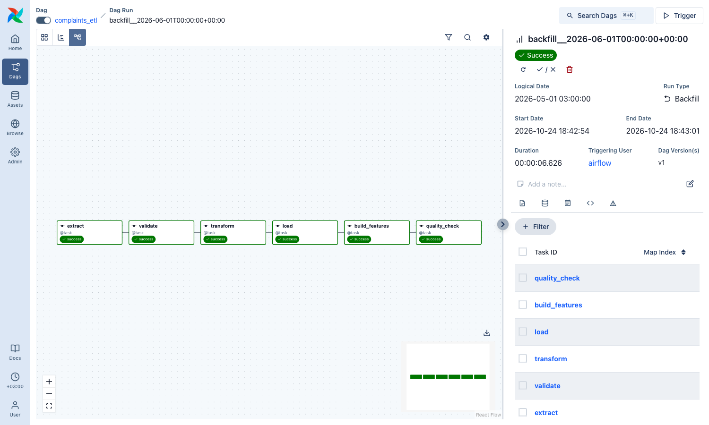
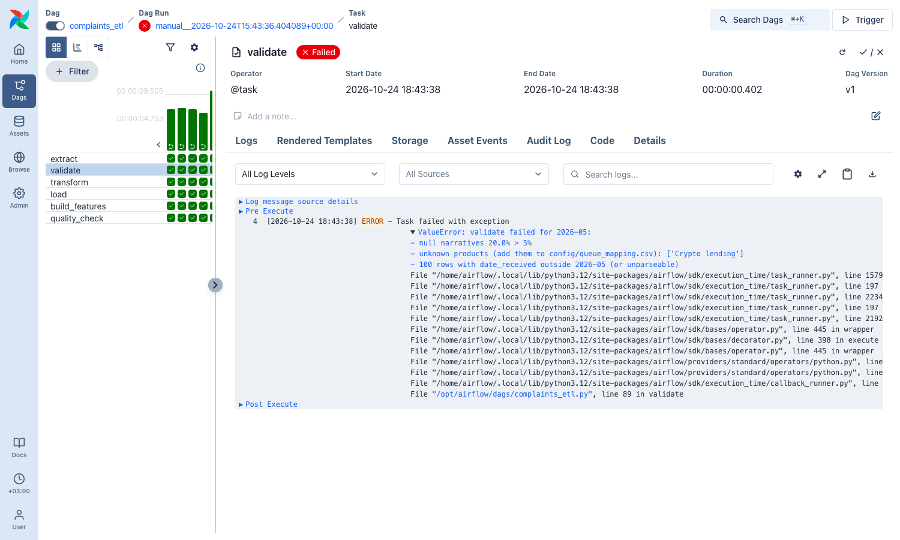
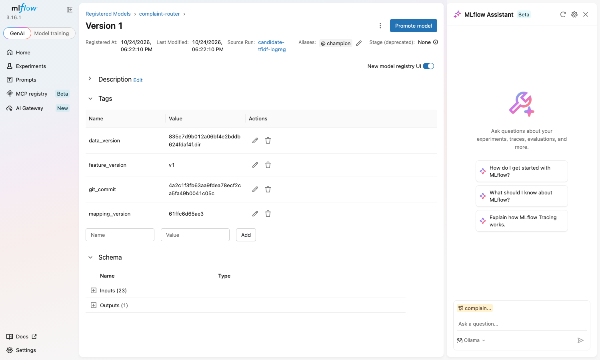

# Complaint routing — keeping a text classifier up to date

A consumer-finance complaint intake service has to send every free-text complaint to the right product review queue, and misrouted complaints wait in the wrong queue while the 15-day response clock runs.
The data behind it moves: the CFPB product taxonomy changed in 2017 and 2023–2024, credit reporting grew from about 20 % to about 90 % of complaints, and on 2026-08-14 the CFPB stopped publishing complaint narratives.
This project builds a system that classifies each complaint narrative into a routing queue at intake, trained on monthly batches of CFPB complaints replayed in time order.
A new model reaches production only after it beats the current one on the most recent held-out months, and drift in language, queue mix and upstream schema is monitored before labels arrive 15–60 days later.
The design is in [docs/design.md](docs/design.md); the course builds it over five labs (pipeline, LLM assistant, serving and monitoring, agent).

## Quick start

```bash
make setup   # pinned environment (uv), pre-commit hook, local .env from .env.example
make lint    # ruff, the same check CI runs on every push
make test    # unit tests of the cleaning rules, the quality gate and the point-in-time feature
make up      # PostgreSQL 16, MinIO, MLflow 3.16.1, Airflow 3.3.1 (docker compose)
```

| Service | URL (localhost only) | What it holds |
|---|---|---|
| Airflow 3.3.1, LocalExecutor | <http://localhost:8080> | DAG `complaints_etl` (no login: local simple auth manager) |
| MLflow 3.16.1 | <http://localhost:5050> | runs (PostgreSQL db `mlflow`), artifacts (MinIO bucket `mlflow`), registry |
| MinIO (`pgsty/silo:RELEASE.2026-09-16T00-00-00Z`) | API <http://localhost:9310>, console <http://localhost:9311> | bucket `dvc` (DVC remote), bucket `mlflow` |
| PostgreSQL 16 | `localhost:5433` | databases `airflow`, `mlflow`, `warehouse` (schemas `raw`, `dwh`, `features`, `feast_online`) |

Credentials live in `.env` (copied from `.env.example`, never committed). The Makefile exports them, so every command below works as written.

## Lab 2

### 1. Raw data, versioned with DVC

- **Source:** the CFPB Consumer Complaint Database narratives archive (FOIA reading room), 18 ZIP exports covering 2022-01 → 2026-07, 1.1 GB zipped, downloaded on 2026-10-24.
- **Sample (the archive is far above 200 MB):** for each month, take the complaints that have a published narrative, drop duplicate `Complaint ID`s, sort by `Complaint ID`, and draw 1,500 rows with `pandas.DataFrame.sample(random_state=YYYYMM)`. Columns are kept exactly as delivered. 55 files `data/raw/complaints_YYYY-MM.parquet`, 82,500 rows. Code: [`ingest.py`](src/complaint_routing/ingest.py).
- **Remote:** S3-compatible MinIO, `s3://dvc/complaint-routing` at `http://localhost:9310`. The remote config is committed ([`.dvc/config`](.dvc/config)); the keys come from `AWS_ACCESS_KEY_ID` / `AWS_SECRET_ACCESS_KEY` in `.env`.

Retrieve the data on a clean clone:

```bash
make setup && make up && make data-pull
uv run dvc status data/raw.dvc      # -> "Data and pipelines are up to date."
```

What arrives must match [`data/raw.dvc`](data/raw.dvc): **md5 `835e7d9b012a06bf4e2bddb624fdaf4f.dir`, 55 files, 26,111,493 bytes**. This md5 is the data version every pipeline row and every MLflow run carries.

The remote is a container, so on a different machine its bucket starts empty. Then rebuild the files from the public archive and seed your remote; the build is deterministic (two builds gave identical md5 for all 55 files), and `--verify` runs `dvc status` against the committed hash:

```bash
make data-rebuild && make data-push
```

### 2. ETL pipeline: `complaints_etl`

[`dags/complaints_etl.py`](dags/complaints_etl.py): `extract → validate → transform → load → build_features → quality_check`.



- **The batch is the data interval, never the clock.** Airflow 3 no longer creates intervals for `@monthly` (start == end), so the DAG declares `schedule=CronDataIntervalTimetable("@monthly", timezone="UTC")`: a run for logical date 2026-05-01 has the interval [2026-05-01, 2026-06-01) and processes month `2026-05`. A manual run has no interval in Airflow 3, so it must pass `{"month": "YYYY-MM"}` in the conf, or it fails with that message.
- **Run a specific interval:** `make etl-month MONTH=2026-05` (an Airflow backfill of exactly that interval; reruns it even if it succeeded). All months in order: `make etl-backfill` (55 runs, `max_active_runs=1`, because the features of month M read months M-5..M-1).
- **Layers in PostgreSQL `warehouse`:** `raw.complaints` (as delivered + `data_version`), `dwh.complaints` (typed, cleaned, mapped to a queue), `features.complaint_features`.

**Idempotency.** `load` and `build_features` delete the batch month and insert it again in one transaction ([`warehouse.replace_month`](src/complaint_routing/warehouse.py)). The same interval, run twice:

```text
### run 1: make etl-month MONTH=2026-05
backfill__2026-06-01T00:00:00+00:00|success|2026-05-01 00:00:00+00|2026-06-01 00:00:00+00
  layer   | count
----------+-------
 raw      |  1500
 dwh      |  1411
 features |  1411

### run 2: make etl-month MONTH=2026-05
backfill__2026-06-01T00:00:00+00:00|success|2026-05-01 00:00:00+00|2026-06-01 00:00:00+00
  layer   | count
----------+-------
 raw      |  1500
 dwh      |  1411
 features |  1411
```

The whole warehouse stays at 82,500 raw / 71,419 dwh / 71,419 feature rows after both runs. 1500 → 1411: `transform` removed 89 duplicate narratives (the same text filed more than once) in that month.

**Quality gate.** `validate` checks the raw batch against its contract before anything is written: schema (16 columns), ≥ 500 rows, ≤ 5 % null narratives, no product missing from [`config/queue_mapping.csv`](config/queue_mapping.csv), every `Date received` inside the batch month, no duplicate ids, and not the same file as the previous month (stale partition). `quality_check` checks the warehouse after the load: rows equal to what `transform` produced, features for every row, no row outside the month, one `feature_version`.

How it was shown to fail: `make bad-batch` writes [a broken copy of 2026-05](src/complaint_routing/fixtures.py) (300 narratives set to null, 50 rows with the product `Crypto lending`, 100 rows dated 2026-04-30) and triggers the DAG on it. `validate` fails on all three, the downstream tasks never run, and the 2026-05 counts above stay 1500 / 1411 / 1411.



### 3. Feature table and where each feature comes from at serving time

`build_features` fills `features.complaint_features` (one row per complaint, `event_timestamp` = date received, column `feature_version = 'v1'`) with **`company_queue_mix`**: the share of each of the 10 queues among the company's complaints received in [d − 150 days, d − 60 days), plus their count `mix_n`. The 60-day lag is the label delay: a complaint's final queue is known only when it closes. The serving-time source of every feature is the table in [design 5.3](docs/design.md#53-techniques). Training builds exactly the same table from the DVC files; checked: all 71,419 rows match the warehouse, max absolute difference of the mix features 0.0.

**Feast (optional point).** [`feature_repo/`](feature_repo) has its own environment (Feast 0.66 needs pandas < 3). Entity `company`, feature view `company_queue_mix`, offline store = the PostgreSQL table above, online store = schema `feast_online`.

```bash
make feast-apply && make feast-demo
```

```text
two feature rows of CAPITAL ONE FINANCIAL CORPORATION:
event_timestamp  mix_card  mix_checking_savings  mix_n
     2024-03-02  0.453333              0.146667     75
     2024-03-05  0.460526              0.144737     76

get_historical_features at 2024-03-03 12:00:00 (between the two rows):
                          company     event_timestamp  mix_card  mix_checking_savings  mix_n
CAPITAL ONE FINANCIAL CORPORATION 2024-03-03 12:00:00  0.453333              0.146667     75

OK: Feast returned the earlier row; the later one is after the entity timestamp.
```

`make feast-materialize` loads the latest row per company into the online store (19,052 rows) for the Lab 4 service.

### 4. Baselines and model on a time split

Train 2022-01 → 2026-02 (64,269 rows), validation 2026-03 → 04 (2,856), test 2026-05 → 07 (4,294); why not a random split: [design 5.4](docs/design.md#54-experimentation-and-validation). `make train`.

| Test 2026-05 → 07 | macro-F1 | accuracy | min recall over queues | accuracy re-weighted to the full intake mix |
|---|---|---|---|---|
| Majority queue (always `credit_reporting`) | 0.008 | 0.042 | 0.000 | **0.914** |
| Keyword rules, fallback to majority | 0.524 | 0.523 | 0.186 | 0.764 |
| **TF-IDF + one-hot + company mix → logistic regression** | **0.776** | **0.830** | 0.270 (`debt_management`) | 0.869 |

The trained model beats both rules on the metric the design optimizes (macro-F1). On the last column the majority rule wins: 91.4 % of all complaints in the test months are credit reporting, so "always credit reporting" is right 91 % of the time and routes nothing else. That is why accuracy is not a target ([design 3](docs/design.md#3-success-metrics)). Every queue except `debt_management` (37 test rows) has recall ≥ 0.71; that one queue misses the 0.60 recall target.

### 5. Experiment tracking, registry and reproduction

MLflow runs as a server with a PostgreSQL backend store and MinIO artifacts (`docker compose`). Every run logs its parameters, metrics and tags `data_version` (DVC md5 of `data/raw`), `git_commit`, `git_dirty`, `feature_version`, `mapping_version`. The candidate is registered as **`complaint-router` version 1**, alias **`champion`** (Lab 4 loads `models:/complaint-router@champion`), tagged with both lineage identifiers:



One command reproduces the champion:

```bash
make reproduce
```

It reads `git_commit` and `data_version` from the registered version, checks the commit out into a temporary git worktree, `dvc pull`s that commit's data from the remote, trains there with the logged parameters in an environment built from that commit's `uv.lock`, and compares test macro-F1. **Tolerance: ±0.005 macro-F1**; it covers BLAS/thread scheduling differences between machines, while the data, code, environment and seed are fixed. Output:

```text
$ git worktree add --detach /var/folders/.../repro-2ys05gmt 4a2c1f3fb63aa9fdea78ecf2ca5fa49b0041c05c
$ uv run --frozen dvc remote modify --local minio endpointurl http://localhost:9310
$ uv run --frozen dvc pull data/raw.dvc
$ uv run --frozen python -m complaint_routing.train --no-register --only-candidate ... --c 4.0 --max-features 100000 --min-df 3 --seed 42
$ git worktree remove --force /var/folders/.../repro-2ys05gmt

test_macro_f1: registered 0.7762, reproduced 0.7762 (run bb8664305a5c42f7a10608672e2ed3e7)
|diff| 0.0000 <= tolerance 0.005 -> REPRODUCED
```

The remote address is taken from today's `.dvc/config`, the data hash from the commit: the remote moved from port 9010 to 9310 after version 1 was trained, and the data it pulls is still identified by the same md5.

### Hardware and timing

MacBook Pro M1 Pro, 16 GB, Docker Desktop 28.3.2 (8 GB for containers). Raw build 1.5 min; one DAG run ≈ 6 s, the 55-month backfill ≈ 7 min; training ≈ 8 min on CPU; `make reproduce` ≈ 9 min (it also builds a fresh environment).

## Maturity scorecard

| Property | Evidence a reviewer checks | Added in |
|---|---|---|
| Repository reproducible from a clean clone | CI is green; `make setup` and `make lint` succeed on a fresh clone | Lab 1 |
| Design document exists and is current | `docs/design.md` follows the template, every section filled or marked as an assumption | Lab 1 |
| Data versioned | `make data-pull` retrieves `data/raw` and `dvc status` matches md5 `835e7d9b…dir` ([1](#1-raw-data-versioned-with-dvc)) | Lab 2 |
| Pipeline idempotent | the same interval run twice gives 1500 / 1411 / 1411 rows both times, pasted in [2](#2-etl-pipeline-complaints_etl) | Lab 2 |
| Quality gate present | `make bad-batch` fails `validate` on three named rules; [screenshot](docs/screenshots/airflow_failed_validate.png) | Lab 2 |
| Experiments tracked | every run in experiment `complaint-routing` has params, metrics, `data_version` and `git_commit` ([5](#5-experiment-tracking-registry-and-reproduction)) | Lab 2 |
| Model registered with lineage | `complaint-router` v1 `@champion` tagged with data version and commit; `make reproduce` gives the same macro-F1 | Lab 2 |
