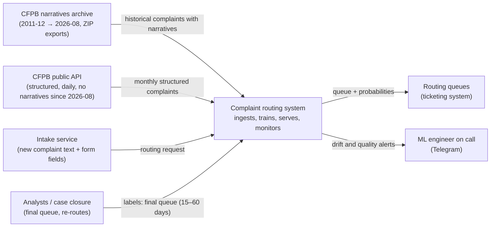
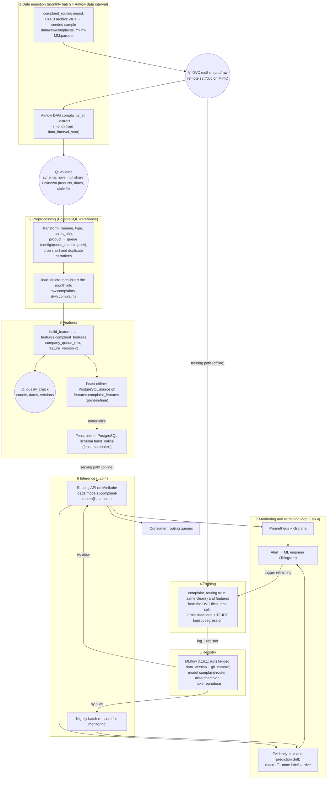
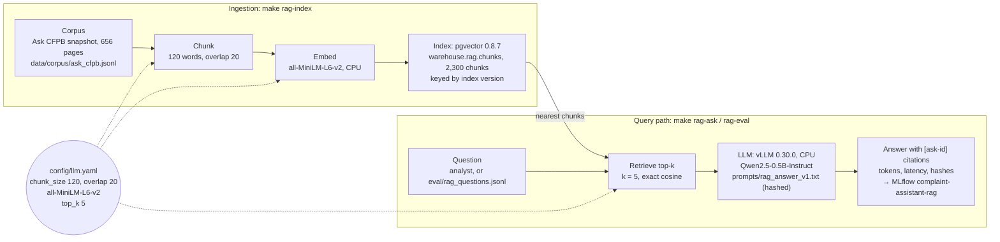
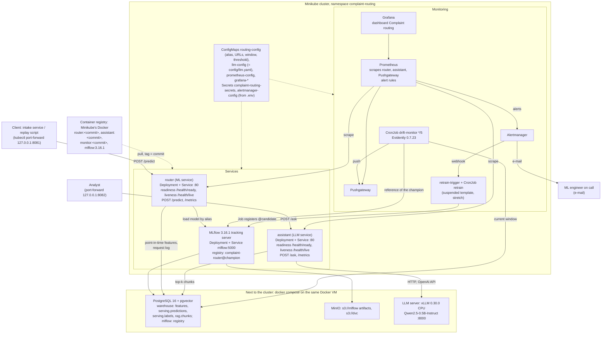
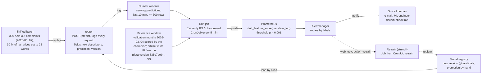

# Complaint routing — design document

> Status: Lab 4. Sections 5.5, 6.1, 6.2, 6.3, 6.4, 6.6, 6.7, 6.9, 7.3 and 7.4 now describe the deployed system (two services on Minikube, the registry in the cluster, scheduled drift monitoring, alerting to a human, alert-triggered retraining) as built and measured. Lab 3 added the LLM component to 5.1, 5.3, 5.4, 6.1, 6.3, 6.7, 7.1 and 7.2; statements still marked **Assumption** are decisions taken without data yet.
> Section numbers follow the [ml-design-docs](https://github.com/eugeneyan/ml-design-docs) template and must not change.

## 1 Overview

A consumer-finance complaint intake service receives free-text complaints and has to send each one to the right product review queue (credit reporting, debt collection, mortgage, …). Today routing is manual or depends on the product the consumer picks, which is often wrong; misrouted complaints wait in the wrong queue and miss the 15-day response deadline. We build a system that classifies each complaint narrative into a routing queue at intake, learns from monthly batches of newly closed complaints, and is monitored for drift in language, product mix and taxonomy. The desired outcome is fewer manual re-routes, and a model that keeps up with new products and taxonomy changes instead of decaying silently.

## 2 Motivation

- **Who consumes the predictions.** The intake service calls the model once per new complaint and puts the complaint into the predicted queue. Analysts in each queue work the complaint and re-route it by hand when it is wrong.
- **How often.** Online, one request per complaint at submission.
  - Our data source, the CFPB Consumer Complaint Database, reached about 490–620 k complaints per month in 2026, measured on the public API on 2026-10-19.
  - **Assumption:** our intake service handles a 5 % slice, ≈ 1,000 complaints per day.
  - The model is retrained monthly.
- **What happens when it is wrong.**
  - The complaint sits in the wrong queue until an analyst notices, then is re-routed. Every re-route costs analyst time and eats into the company's 15-day response window.
  - Errors are not uniform. A rare product (student loans, virtual currency) sent to the huge credit-reporting queue can wait for days.
- **Why a notebook is not enough.** The data moves:
  - The product taxonomy changed in 2017 and again in 2023–2024. The API shows *Credit reporting* → *Credit reporting, credit repair services, …* → *Credit reporting or other personal consumer reports*, and *Credit card or prepaid card* → *Credit card*.
  - The product mix shifted: credit reporting grew from about 20 % of complaints in 2015 to about 90 % in 2026.
  - On 2026-08-14 the source stopped publishing narratives altogether (see 5.2).

  A model trained once is wrong about all three, and only a system with versioned data, time-based validation and monitoring notices.

## 3 Success metrics

| Layer | Metric | Target | Type |
|---|---|---|---|
| Business | Manual re-route rate: share of complaints an analyst moves to another queue | ≤ 10 % (**Assumption**: the current manual baseline is unknown; measured from labels once the system runs) | optimizing |
| Business | Complaints that miss the 15-day response window because of misrouting | not higher than before the model (**Assumption**) | satisficing |
| Model | Macro-F1 over routing queues on the held-out months | maximize; must beat the production model and the majority-class baseline | optimizing |
| Model | Recall per queue | ≥ 0.60 for every queue, so small queues are not sacrificed to credit reporting | satisficing |
| System | Prediction latency p95 at the model service | ≤ 300 ms per complaint | satisficing |
| System | Availability of the model service | 99.5 % monthly; on failure, complaints go to a general triage queue | satisficing |
| System | Model freshness | a model trained on data no older than 2 months is in production | satisficing |

Accuracy is deliberately not a target. Among all complaints, credit reporting is 91 % (May 2026), so a model that always says "credit reporting" reaches 0.91 accuracy on that population and is useless for routing. Among complaints with a narrative, the largest queue is only 33 % (5.2), so accuracy also changes meaning with the population. Macro-F1 does not.

## 4 Requirements and constraints

### Functional

- **F1. Ingest** a monthly batch of complaints:
  - historical text from the CFPB narratives archive, replayed month by month;
  - structured records from the live CFPB API.
- **F2. Version** each raw batch and each built dataset, so any model traces back to its exact rows.
- **F3. Validate** each batch with a quality gate before it is used:
  - schema check;
  - share of null narratives;
  - unknown product names;
  - date range;
  - duplicate complaint ids;
  - narrative length below 50 characters, and duplicate narrative text (pasted boilerplate).
- **F4. Map products to routing queues** with a versioned mapping table. The table absorbs taxonomy renames, so old and new product names land in the same queue.
- **F5. Train** a candidate on all months up to *t*, evaluate it on held-out months, and log parameters, metrics, data version and commit to MLflow.
- **F6. Register** the candidate with lineage. Promotion needs a passing comparison and a human approval.
- **F7. Serve** an HTTP endpoint:
  - input: `{complaint_id, narrative, company, state, submitted_via, tags}`;
  - output: `{queue, probabilities, model_version}`.
- **F8. Monitor** inputs, predictions and service health. When labels arrive, monitor quality too. Alert a human when a threshold is crossed.

### Non-functional (one row per category)

| Category | Requirement |
|---|---|
| Freshness | A new monthly batch is ingested, validated and available for training within 24 h of the month closing. Company features in the online store are at most 24 h old. The production model is retrained monthly and is never older than 2 months. |
| Latency and throughput | p95 ≤ 300 ms per request. Sustained ≥ 5 requests/s on one CPU pod (**Assumption**: ≈ 1,000 complaints/day on average, so a 10× peak is about 0.1 req/s; the headroom is for batch re-scoring and load tests). |
| Availability and fallback | 99.5 % for the model service. If the model or the feature store is unavailable, the intake service sends the complaint to the general triage queue and logs the fallback. If a requested model version fails to load, the pod is not ready, and the previous version keeps serving. |
| Reproducibility | Any registered model can be rebuilt with one command from a git commit plus a DVC data version. The environment is pinned by `uv.lock`; random seeds are fixed. |
| Adaptability | A taxonomy rename is a change to the mapping table, not to code. A new product either maps to an existing queue or adds a queue with the next monthly retrain. The time from a new batch to a promoted model is ≤ 1 week. |
| Observability without ground truth | The label (the final queue) is known only when the complaint is closed, 15–60 days after submission (5.2). Until then we monitor proxies: predicted queue mix, confidence distribution, narrative length and vocabulary drift, null-narrative rate, and the fallback rate. |
| Cost and resource ceilings | Everything runs on one laptop (Minikube, 4 GB). Training must finish in ≤ 30 min on a laptop CPU (TF-IDF + linear model on a sampled dataset). Raw data in the lake must stay ≤ 10 GB (**Assumption**: years 2022–2026; the clean layer keeps only rows with a narrative, about 20 k per month in 2026). Cloud estimate in 6.7. |

### In scope

- Monthly ingestion, versioning and validation of complaint batches.
- The product-to-queue mapping.
- Training, evaluation and the registry.
- The online routing endpoint.
- Monitoring and the retraining loop.
- In Lab 3, the LLM complaint assistant (see 7.4).

### Out of scope

- Predicting issue or sub-issue.
- Drafting replies to consumers.
- Routing to a specific company (the consumer names it).
- The intake UI and the analysts' ticketing tool: we only define the contract with them.

## 5 Methodology

### 5.1 Problem statement

- **Framing.** Multi-class text classification: narrative plus a few structured fields → one routing queue out of about 10. Each complaint has exactly one product, so one label per complaint.
- **Rejected framing: classify the issue (≈ 80 classes) and derive the queue from it.** It gives finer routing, but most issues have few examples per month. Issue names also change with the taxonomy even more often than products. The extra granularity is not needed to pick a queue.

**The LLM component (Lab 3).** The system already has a model, so the LLM gets two contracts, each with its own metric:

1. **Same task, done by an LLM (the LLM baseline).** Given the narrative, a zero-shot LLM names one of the 10 routing queues. Its metric is the Lab 2 metric, macro-F1 over queues, computed by the same code on the same test months. The champion is scored on exactly the same rows. The question this answers is whether an LLM without training could replace or back up the trained classifier, for example while a new queue has no labels yet.
2. **An auxiliary job over a corpus: the analyst assistant.** A queue analyst asks a question about the rules or the product behind a complaint ("does the consumer have to dispute with the bureau first?", "how long does a collector have to answer a validation request?"). The assistant retrieves passages from the CFPB's own consumer guidance and answers in 2–4 sentences, citing the document ids. Its metrics are retrieval hit rate and MRR, and an answer-correctness rate graded by an LLM judge against reference answers (5.4). It does not route complaints and does not write to the consumer: a human reads it.

**The corpus: Ask CFPB, the CFPB's consumer Q&A** (consumerfinance.gov/ask-cfpb).
- One page per question, grouped in categories that mirror the complaint products: debt collection, credit reports and scores, mortgages, bank accounts, credit cards, auto loans, student loans, payday loans, money transfers, prepaid cards.
- Each page explains what the law requires (FCRA, FDCPA/Regulation F, Regulation E, Regulation Z), in plain language: what an analyst needs to judge a complaint.
- Every English answer listed in the site's sitemap.xml: 673 pages fetched on 2026-11-07, of which **656** have an answer of at least 200 characters, 211,230 words in total (median 261 words per page). One JSONL snapshot, `data/corpus/ask_cfpb.jsonl` (1.5 MB, committed, md5 `f9e1907f…`). Public: a US federal government work, no copyright.
- The snapshot, not the live site, is the corpus version: its md5 is logged on every run, and `make corpus` re-fetches it (which produces a new version).
- This replaces the Lab 1 plan of regulation summaries plus past narratives. Regulation text (eCFR) is long and legalistic, while Ask CFPB already summarises it per consumer question. Past narratives have no "relevant document" for a question, so retrieval over them cannot be scored with hit rate.

### 5.2 Data

**Sources**

- **CFPB Consumer Complaint Database Narratives Archive** (FOIA reading room). It holds complaints received between 2011-12-01 and 2026-08-14, as ZIP exports per month or multi-month period.
  - Recent files are 10–75 MB each, from HEAD requests on 2026-10-19.
  - **Verified on `CCDB_Export_21_August_2026.zip`** (2026-10-19): one CSV with the classic export schema, 16 columns:
    - `Date received`, `Product`, `Sub-product`, `Issue`, `Sub-issue`;
    - `Consumer complaint narrative`, `Company public response`;
    - `Company`, `State`, `ZIP code`, `Tags`, `Submitted via`;
    - `Date sent to company`, `Company response to consumer`, `Timely response?`, `Complaint ID`.
    - There is no consent column.
  - **August 2026 contains 667,140 complaints but only 1 narrative.** The month is effectively text-free.
  - **Verified on `CCDB_Export_18_May_2026.zip`:**
    - May 2026 has 619,940 complaints, of which 17,528 (2.8 %) have a narrative.
    - The weekly count grows from 3,311 to 4,924 through the month.
    - The median narrative is 1,053 characters long; 77.9 % contain `XXXX` masks.
  - **Checked in Lab 2 (2026-10-24), all 55 months 2022-01 → 2026-07:** every month has between 10,002 (2026-07) and 172,937 (2025-01) complaints with a narrative; June 2026 has 16,820. August does not (above).
  - Lab 2 uses the 18 exports that cover 2022-01 → 2026-07 (1.1 GB zipped; list in `src/complaint_routing/ingest.py`).
  - This is the text source for training.
- **Live CFPB API** (`consumerfinance.gov/data-research/consumer-complaints/search/api/v1/`, CC0 licence).
  - Structured complaints, updated daily: 18.5 M records in total on 2026-10-19.
  - **Since 2026-08-14 it publishes no narratives.** The CFPB ended narrative publication; the structured fields are still published.
  - We use it to monitor the product mix after August 2026, and as a real case of an upstream schema change (6.6, 6.9). It is not ingested in Lab 2; Lab 4 adds it.

**Arrival pattern and batch grain.**
- **One batch = one calendar month of `date_received`**, which is exactly one Airflow data interval [month start, next month start).
- Until 2026-08 these come from the archive, **replayed on a simulated clock**: Lab 2's "next month" is the next archive month.
- After 2026-08 they come from the live API, structured fields only.
- The CFPB publishes a complaint after the company responds or after 15 days, whichever comes first, so a month is complete about 15 days after it ends.

**The raw layer as built (Lab 2).**
- **Sample.** Each archive month is far larger than the course needs, so the raw layer is a seeded sample: per month, complaints with a narrative, deduplicated by `Complaint ID`, 1,500 drawn with `sample(random_state=YYYYMM)`. 55 Parquet files, 82,500 rows, 26 MB, all 16 columns as delivered. Rebuilding from the archive gives byte-identical files.
- **Data version identifier:** the DVC md5 of `data/raw`, currently `835e7d9b012a06bf4e2bddb624fdaf4f.dir`. Every row loaded by the pipeline and every MLflow run carries it as `data_version`. Remote: MinIO bucket `s3://dvc/complaint-routing`.
- **Products → queues.** 14 product names occur in 2022–2026 (old and new taxonomy); `config/queue_mapping.csv` maps them to **10 queues**. *Credit card*, *Credit card or prepaid card* and *Prepaid card* share one queue `card`, because the 2017–2023 taxonomy did not separate them.
- **Cleaning removed 11,081 of 82,500 sampled rows (13.4 %):** 10,803 narratives whose exact text already appeared in the same month (template complaints filed many times), 278 narratives under 50 characters. No unknown products, unparseable ids or dates.
- **The narrative population itself shifted.** Among sampled complaints with a narrative, credit reporting is **66.8 % in 2022-01 → 2026-02** but **3.8 % in 2026-03 → 2026-07**; debt collection goes from 10.2 % to 29.5 %. In 2025 the CFPB published narratives mostly for credit-reporting complaints (2025-01 alone has 172,937), in 2026 almost none. The validation and test months are therefore a different label distribution from training (prior shift), on top of the selection bias below.

**Labels and their delay.**
- The label is the routing queue, derived from `product` through the mapping table. The current taxonomy has 11 products, so there are 11 queues before mapping.
- In our intake scenario the final queue is known when the complaint is closed.
  - The company gives a first response within 15 days and closes the case within 60.
  - In the August 2026 file, exported on 2026-09-14 (2–6 weeks after receipt), 55.5 % of complaints were still "In progress".
  - **Labels therefore arrive 15–60 days after the prediction.** Most arrive within 60 days (**Assumption**, based on the 60-day closure rule).
- Routing itself is fast in the source: the median time from `Date received` to `Date sent to company` is 0 days, and the 99th percentile is 1 day.
- In the CFPB data the product is chosen by the consumer, so it is a noisy proxy for the true queue (see 6.9).

**Observed in August 2026** (all 667,140 rows):
- 92.9 % of complaints are credit reporting.
- The three credit bureaus (TransUnion, Experian, Equifax) account for 90.7 % of all complaints, out of 1,588 companies.
- 99.6 % are submitted via the web.
- 2.1 % carry a tag (Servicemember, Older American).

**The text data is a very different population** (May 2026, the 17,528 complaints with a narrative):

| Queue | All complaints | With narrative |
|---|---|---|
| Credit reporting | 91.1 % | 4.3 % |
| Debt collection | | 32.7 % |
| Checking or savings account | | 17.4 % |
| Credit card | | 17.3 % |
| Money transfer, virtual currency | | 8.2 % |
| Mortgage | | 6.5 % |
| 5 other queues | | 13.7 % |

Credit-reporting complaints almost never carry a published narrative. The model is therefore trained on a population where credit reporting is a small class, while an intake service would see it as the overwhelming majority. This selection bias is handled in 5.4 and 6.9.

Some narratives are not complaints at all; for example, a pasted chatbot conversation. This is why the quality gate checks length and duplicate text.

**Available at serving vs training time.**

| Field | Training | Serving | Use |
|---|---|---|---|
| Narrative text | yes, PII already scrubbed by CFPB (`XXXX`) | yes, raw text with PII | model input after the same scrubbing step |
| Company, state, submitted via, tags | yes | yes, entered at intake | model inputs |
| Company product mix over the last 90 days | computed point-in-time from history | online feature store | model input |
| Product, sub-product, issue, sub-issue | yes | **no**: the label and its children | label only; never features (leakage) |
| Company response, timely, dates sent or closed | yes | **no**: they happen after routing | label delay and monitoring only |

**Checklist justification**

| Item | Justification |
|---|---|
| Time axis | Every complaint has `date_received`. Monthly batches come from the archive (2011-12 → 2026-08) and the live API (2026-08 → now), so ingestion can literally take "the next month". |
| History to hold out | We use 2022-01 → 2026-07, 55 months, which includes the 2023–2024 taxonomy changes. The split: train on 2022-01 → 2026-02, validate on 2026-03 → 2026-04, test on 2026-05 → 2026-07. May 2026 alone has 17,528 narratives (verified), so the test window is large enough. 2026-08 has 1 narrative in 667,140 rows (verified), so it is not used for text; it is kept for the Lab 4 schema-change demo. **Plan if May–July 2026 are also thin on text:** move the test window back to the last 3 months that each have ≥ 5,000 narratives, and shift validation with it. |
| Labels with known delay | The label is the final queue, known when the complaint closes, 15–60 days after submission (55.5 % of August 2026 complaints were still open after 2–6 weeks). Monitoring therefore uses proxies until complaints close, and real macro-F1 afterwards (6.6). |
| Text surface / corpus | The narratives themselves are the text task. For Lab 3 retrieval, the corpus is CFPB public documents: product and issue definitions, consumer guides (Ask CFPB), and regulation summaries (FCRA, FDCPA, Reg E, Reg Z). Past narratives are the "similar complaints" index. |

### 5.3 Techniques

- **Baseline 1 (trivial).** Always predict the majority queue of the training data. Lab 1 expected debt collection (the May 2026 majority); on the actual training months 2022-01 → 2026-02 it is **credit reporting (66.8 %)**, which is only 4 % of the test months (results in 7.2). This sets the floor.
- **Baseline 2 (rules).** Keyword rules per queue ("mortgage", "escrow" → mortgage; "collector", "owe" → debt collection; …), with fallback to the majority queue. This is the "would a rule do?" check.
- **Candidate.** TF-IDF (word 1–2-grams, `min_df=3`, ≤ 100,000 terms, sublinear tf) on the scrubbed narrative + one-hot company, state, channel and tags (categories with < 20 rows grouped) + the 10 company queue-mix shares → logistic regression with balanced class weights, `C=4`.
  - It is cheap to train on CPU and fast to serve, and the coefficients are explainable.
  - A fine-tuned small transformer (DistilBERT-class) is a later alternative, used only if the linear model misses the per-queue recall target.

**LLM techniques (Lab 3).** Every setting below is in one file, `config/llm.yaml`, read by the index build, the query path, the evaluation and the Lab 4 service; prompts are files in `prompts/`. The sha256 of the effective config and of each prompt file is logged on every run.

| Setting | Value | Why |
|---|---|---|
| LLM | `Qwen/Qwen2.5-0.5B-Instruct`, fp16, on vLLM 0.30.0 (OpenAI-compatible server, CPU) | the largest model that leaves room for the rest of the stack in 8 GB of Docker memory (6.3, 7.1) |
| Decoding | temperature 0, max 256 tokens (answers), 10 tokens (queue names), 3 tokens (judge) | deterministic, so a rerun of the same config gives the same answers |
| LLM baseline prompt | `prompts/classify_v2.txt`: the narrative (cut to 2,000 characters) first, then the 10 queue names with their typical products, "reply with the product name only". v1 (queues first, narrative last) made the model answer `credit_reporting` 91 % of the time | zero-shot: no labelled examples, so it works for a queue that has none yet |
| Chunking | sliding window over words, **120 words, overlap 20** → 2,300 chunks | an Ask CFPB answer has a median of 261 words (90th percentile 614); 120 words is one or two paragraphs (sweep in 7.2) |
| Embedding model | `sentence-transformers/all-MiniLM-L6-v2` (384 dimensions, CPU) | the whole index (2,300 chunks) builds in 57 s on the laptop CPU; best hit rate@1 and MRR of the three models tried (7.2) |
| Vector index | pgvector 0.8.7 in the existing PostgreSQL 16 (`warehouse`, schema `rag`), exact cosine search | one database fewer than Qdrant (7.1); a few thousand chunks need no approximate index |
| Retrieval | top-k = **5** chunks | |
| Answer prompt | `prompts/rag_answer_v1.txt`: answer from the excerpts only, 2–4 sentences, cite `[ask-<id>]`, say "The documents do not answer this." otherwise | citations make "the answer cites a document the retriever never returned" measurable |
| Judge prompt | `prompts/judge_v1.txt`: does the candidate state the same key fact as the reference? YES/NO | binary verdicts are easier to check by hand than a 1–5 scale. Measured: it agrees with the hand rubric on 39 % of answers, so the hand rubric is the answer metric of record (5.4, 7.2) |

The index is keyed by an **index version**: hash of (corpus md5, chunk size, overlap, embedding model). Indexes for different settings live side by side in `rag.chunks`, so an experiment never overwrites the served index, and the query path refuses to run when the index for the current config and corpus has not been built.

**Features and their serving-time source.**

| Feature | Training-time source | Serving-time source |
|---|---|---|
| Narrative TF-IDF | archive narrative, already scrubbed by CFPB | raw intake text → **our** `scrub_pii()` → same versioned vectorizer |
| Narrative length, `XXXX` share (computed in `dwh.complaints`; quality and monitoring inputs, not model inputs in v1) | archive narrative | computed by the same code from the request |
| Company (one-hot, companies with < 20 training rows grouped) | archive `company` | intake form field |
| State, submitted via, tags | archive fields | intake form fields |
| `company_queue_mix` (`mix_<queue>` for 10 queues + `mix_n`; `feature_version = v1`) | `features.complaint_features`, filled by the pipeline task `build_features`; Feast offline store = that table, point-in-time join | Feast online store (PostgreSQL schema `feast_online`), refreshed by `feast materialize` |

**Definition of `company_queue_mix`.** For a complaint received on day *d*: the share of each queue among the same company's complaints received in [*d* − 150 days, *d* − 60 days), and their count. The window ends 60 days before *d* because the final queue of a complaint is known only when it closes, up to 60 days after receipt (5.2). A window [*d* − 90, *d*) would read labels that do not exist yet at serving time. The pipeline computes it month by month from the warehouse; training computes it from the DVC files with the same function. Both give identical values for all 71,419 rows (checked in Lab 2).

Two fields carry less signal than they seem:
- `Submitted via` is 99.6 % web. It is kept because it costs nothing, but it barely helps.
- `Company` nearly decides credit reporting on its own: the three bureaus account for 90.7 % of complaints. The text matters for everything else.

Two features have a serving-time source that differs from the training-time source:
- **Narrative.** CFPB scrubbed the training text with its own tool, while serving text is raw and goes through our `scrub_pii()`. If the two scrubbers differ, the text differs.
- **Company queue mix.** Training reads the exact point-in-time value per complaint; serving reads the latest materialized value per company, which can be up to one refresh old.

### 5.4 Experimentation and validation

- **Split by time.**
  - Train on 2022-01 → 2026-02, validate on 2026-03 → 2026-04, test on 2026-05 → 2026-07.
  - A random split would mix months before and after a taxonomy change, and complaints from one company campaign, into both sides. It would also let the 90-day company feature see the future, so the score would overstate what the model does next month.
  - For monthly retrains we use a rolling window: train on everything up to *t−1*, test on month *t*.
- **Population check.** The test months contain only complaints with a narrative, where credit reporting is 4 %. Besides the plain test score, we report accuracy re-weighted to the full queue mix of the same months: Σ over queues of (share of the queue among *all* 1,912,770 complaints of 2026-05 → 07) × (recall of the queue). The mix (credit reporting 91.4 %) is in `config/test_population_mix.csv`, built from the archive by `make population-mix`.
- **Why the split must be by time here, in numbers.** Credit reporting is 66.8 % of the training months and 3.8 % of the test months (5.2). A random split would put both periods on both sides and report a score for a label mix that no future month has.
- **Offline metric.** Macro-F1 over queues (optimizing), with per-queue recall ≥ 0.60 (satisficing). We also report a confusion matrix and the per-queue support.
- **New vs current model.** Lab 2 registers the first model (`complaint-router` v1) and sets the alias `champion` directly, since there is nothing to compare against. From version 2 on, both are scored on the same latest held-out month(s), and the candidate is promoted only if:
  - macro-F1 ≥ production + 0.01;
  - no queue's recall drops by more than 5 pp;
  - every queue's recall stays ≥ 0.60;
  - p95 latency in the service load test stays ≤ 300 ms.

**Evaluating the LLM component (Lab 3).**
- **LLM baseline (routing).** 300 complaints drawn from the test months with a fixed seed (natural queue mix). The LLM and the registered champion are scored on exactly these rows with the Lab 2 metric code (macro-F1, accuracy, recall per queue). A reply that names no queue counts as wrong and is reported as `test_unparsed_rate`. Why a sample: on a laptop CPU one LLM call takes seconds, so the full 4,294-row test set would take hours.
- **Evaluation set for the assistant.** `eval/rag_questions.jsonl`, **57 questions** spread over all 10 queues, each with 1–2 relevant document ids and a 1–2-sentence reference answer.
  - The questions were **generated with an LLM (Claude) from the corpus, then read and corrected**: each reference answer was checked against its document.
  - **No question quotes its document.** Questions describe the situation as an analyst would see it in a complaint ("the agency told her boss…") instead of using the page title or product names ("security freeze", "remittance", "money mule", "payroll card" never appear). A script checked for shared 3-word phrases between each question and its document title; the four hits were generic ("is there a", "a charge on") or were rephrased.
  - Relevance is labelled **per document, not per chunk**: chunk ids change with the chunk size, and the sweep must be scored against the same labels. A second relevant document is listed when another page answers the same question (Ask CFPB has near-duplicates, e.g. two pages on cancelling a money transfer).
- **Retrieval metrics** (our code, `llm/metrics.py`): hit rate@k (share of questions with a chunk of a relevant document in the top k) and MRR@10 (mean of 1 / rank of the first such chunk), from the top 10 chunks.
- **Answer metric:** `answer_correct`, the share of questions where an LLM judge (`prompts/judge_v1.txt`, hashed like any prompt) says the answer states the same key fact as the reference. Also logged: refusal rate, citation rate, and `cited_outside_retrieved_rate` (the answer cites a document id the retriever did not return: a hallucinated citation).
- **The judge is checked by hand**, because it can be wrong in two ways: it can accept a fluent answer that misses the key fact (false YES), or reject a correct answer phrased differently (false NO). The judge is the same 0.5B model that wrote the answers, which also biases it towards its own phrasing.
- **Hand rubric (the answer metric of record).** Correct = a reader learns the key fact of the reference answer, without a contradiction. Applied to every third question (19 per configuration) in `eval/hand_grades.csv`, each grade keyed by the sha256 of the graded answer text, so `evaluate` counts a grade only for that exact answer and logs `answer_correct_hand`, `hand_graded_n` and `judge_agreement_hand` on the run. Measured: judge v1 agrees with the rubric on 22 of 57 graded answers (33 false YES, 2 false NO); a stricter judge v2 says NO to every answer. Neither is usable at 0.5B (7.2).
- **Bias from a generated evaluation set.** The questions were written by a different and much larger model (Claude) than the one that answers (Qwen2.5-0.5B), which avoids the worst case of a model grading its own phrasing; the remaining bias is that generated questions follow the documents' structure. Mitigation: questions rephrased as complaint situations, reference answers checked by hand against the documents.
- **One parameter at a time.** The served settings are the baseline; a sweep changes one of chunk size, embedding model or top-k across ≥ 3 values, every run logged with its index version and hashes; results in 7.2.

### 5.5 Human in the loop

- **Drift alert (Lab 4, as built).** Prometheus evaluates the rules in `k8s/monitoring/rules.yml`; Alertmanager e-mails the **ML engineer on call (the project owner)**, subject `[complaint-routing] FIRING: <alert> (<severity>)`, with a summary and a link to the runbook section. What to do in the first ten minutes is written in [`docs/runbook.md`](runbook.md): look at the Grafana dashboard "Complaint routing" and the window's Evidently report (MLflow experiment `complaint-routing-monitoring`), read a few rows of the window (`make psql-window`), then decide: upstream change (tell the intake team; retraining does not help), real change in complaints (review the retraining candidate), or replay/test traffic (silence with a reason). `page` alerts: within the hour in working hours; `ticket` alerts: within a working day. The e-mail thread is where the decision is written down.
- **Model promotion.** Training (by hand with `make train`, or the alert-triggered retraining Job of the stretch goal) registers a new version with the alias `candidate` and a `promotion_gate` tag (validation macro-F1 ≥ the champion's and every queue recall ≥ 0.60). Nothing moves `champion` automatically. The ML engineer reads the comparison and runs `make promote VERSION=<n>`: the alias `champion` moves to `<n>`, the version it replaces gets the alias `previous`, and the router Deployment is restarted; it resolves the alias at start-up, so no image is rebuilt (README, Lab 4, 3). **Assumption:** in a real intake team, the queue lead also signs off when a queue is added or removed.
- **Override.**
  - Analysts re-route any complaint by hand; every re-route is logged and becomes a label (`serving.labels`).
  - Rollback is the same command with the `previous` version: `make promote VERSION=<previous>`. The intake falls back to the general triage queue on any 5xx or timeout (6.8), which is also what happens while no router pod is ready.
- **Taxonomy change.** A new product name fails the quality gate as "unknown product". A human adds it to the mapping table; that is a versioned change reviewed in a pull request. The router refuses to load a model whose `mapping_version` tag differs from the mapping in its image (it stays not ready), so a model and an image with different queue lists never serve together.

## 6 Implementation

### 6.1 High-level design

#### System context

#### Data flow (seven layers)

Real component names as of Lab 2; layers 6–7 as first planned (built in Lab 4 as drawn in *Deployment* below: the routing API reads features point-in-time from the feature table and the prediction log replaces the nightly re-score as the monitoring input). The three marks are drawn as circles:
- **V**, the version point: DVC md5 of `data/raw`, stamped on every row as `data_version`;
- **Q**, the quality gate: Airflow tasks `validate` (raw contract) and `quality_check` (loaded data);
- **the split** between the offline side (training) and the online side (serving), inside layer 3.

**Changed from the Lab 1 plan.**
- The raw batch is versioned as Parquet files in the repository's DVC workspace and loaded into a PostgreSQL `raw` schema, not written to a MinIO `raw/` prefix. One store fewer, and the DVC md5 already identifies the bytes.
- Training reads the DVC files and recomputes the warehouse tables with the same functions instead of reading the warehouse. A run then depends only on (data version, commit), so `make reproduce` works without replaying the whole pipeline. The two paths were checked to give identical rows and features.
- The Feast offline store is the PostgreSQL feature table, not Parquet on MinIO.

The narrative is not stored in the feature store: it arrives with the request. The vectorizer and `scrub_pii()` ship inside the registered model, so the training and serving paths run the same code on the text.

#### Retrieval pipeline (Lab 3)

Ingestion on top, the query path underneath; every setting comes from one file, `config/llm.yaml`.

The evaluation loop runs the same query path on the question set, computes hit rate@k and MRR from the retrieved chunks and an answer-correctness rate from the judge (`prompts/judge_v1.txt`, hashed), logs one MLflow run, and is repeated with one setting changed at a time (`make rag-sweep`, results in 7.2).

The LLM baseline for routing is a separate, shorter path: test narrative → `prompts/classify_v1.txt` → the same vLLM server → queue name → macro-F1, logged in the Lab 2 experiment `complaint-routing`.

#### Deployment (Lab 4, as built)

The real cluster topology. Two services with a Deployment, a Service and both probes each; the tracking server with the registry inside the cluster; monitoring and configuration inside the cluster; the storage layer and the LLM server next to it on the same Docker VM, reached by pods as `host.minikube.internal` (in a cloud this is RDS, S3 and an LLM endpoint next to EKS). Everything is in namespace `complaint-routing` of the Minikube profile `complaint-routing` (Kubernetes 1.30.0, docker driver, 4 GB, 2 CPUs). Images are built inside Minikube and tagged with the git commit; `imagePullPolicy: Never`, so a pod can only run an image built from this repository.

#### Drift-to-action loop (Lab 4)

### 6.2 Infra

| Component | Local (pinned) | AWS | GCP | Azure |
|---|---|---|---|---|
| Object storage, data lake | MinIO-compatible `pgsty/silo:RELEASE.2026-09-16T00-00-00Z`; buckets `dvc`, `mlflow` | Amazon S3 | Cloud Storage | Blob Storage |
| Data versioning remote | DVC 3.67.1 + dvc-s3 3.3.0, remote `s3://dvc/complaint-routing` on MinIO | S3 remote | GCS remote | Azure Blob remote |
| Warehouse / serving DB | PostgreSQL 16, one instance, databases `warehouse` (schemas `raw`, `dwh`, `features`, `feast_online`), `airflow`, `mlflow` | Amazon RDS | Cloud SQL | Azure Database for PostgreSQL |
| Orchestrator | Apache Airflow 3.3.1 (`apache/airflow:3.3.1-python3.12`, `airflow standalone`), LocalExecutor, DAG `complaints_etl` | Amazon MWAA | Cloud Composer | Azure Data Factory |
| Experiment tracking, registry | MLflow 3.16.1 (image built from `python:3.12-slim`, no official 3.16.1 image), PostgreSQL backend, MinIO artifacts proxied by the server | SageMaker with MLflow | Vertex AI Experiments + Model Registry | Azure ML with MLflow |
| Feature store | Feast 0.66.0, separate environment in `feature_repo/` (it needs pandas < 3); offline and online store: PostgreSQL | SageMaker Feature Store | Vertex AI Feature Store | Azure ML managed feature store |
| Container registry | Minikube's own Docker image store (`minikube image build`, `imagePullPolicy: Never`); images `complaint-routing/{router,assistant,monitor}:<commit>` | Amazon ECR | Artifact Registry | Azure Container Registry |
| Kubernetes cluster | Minikube 1.34.0 (the installed release; the course pins 1.33.1) running Kubernetes 1.30.0 as pinned, profile `complaint-routing`, docker driver, 4 GB, 2 CPUs; namespace `complaint-routing` | Amazon EKS | GKE | AKS |
| Model and data monitoring | Evidently 0.7.23 in the CronJob `drift-monitor` (image `monitor:<commit>`) | SageMaker Model Monitor | Vertex AI Model Monitoring | Azure ML model monitoring |
| Metrics and dashboards | Prometheus 3.5.0, Pushgateway 1.11.1, Alertmanager 0.28.1 (e-mail), Grafana 12.1.0, plain manifests (no operator: it does not fit in 4 GB with the rest) | Amazon CloudWatch | Cloud Monitoring | Azure Monitor |
| Vector store (Lab 3) | pgvector 0.8.7 in the same PostgreSQL 16 (`pgvector/pgvector:0.8.7-pg16-trixie`, schema `rag`) | OpenSearch Serverless vector search | Vertex AI Vector Search | Azure AI Search |
| LLM inference (Lab 3) | vLLM 0.30.0, OpenAI-compatible server, CPU image built from source (`vllm-cpu-arm64:0.30.0`), `Qwen/Qwen2.5-0.5B-Instruct` fp16; compose profile `llm`, `127.0.0.1:8000` | Amazon Bedrock | Vertex AI generative AI | Azure OpenAI |
| Embedding model (Lab 3) | sentence-transformers `all-MiniLM-L6-v2`, CPU, in the client process | Bedrock embeddings | Vertex AI embeddings | Azure OpenAI embeddings |

Lab 4 runs the serving and monitoring layers in Minikube and keeps the storage layer (PostgreSQL, MinIO) and the LLM server in docker compose next to it, on the same Docker VM, raised from 8 to 12 GB for this lab (6.7); pods reach them as `host.minikube.internal`. The tracking server runs in both places over the same backend and artifact store: in the cluster for the cluster (`http://mlflow:5000`), in compose for the laptop (training, UI on `localhost:5050`). Airflow is not needed while the cluster runs and stays stopped.

Lab 2 runs layers 1–5 with `docker compose` (`make up`): PostgreSQL, MinIO (+ a one-shot bucket-creating `amazon/aws-cli` container), MLflow and Airflow. The pipeline, training and Feast share one pandas version (3.0.5, the one in the Airflow image) except Feast, which runs in its own environment.

### 6.3 Performance

- **Online, not batch.**
  - A complaint should land in a queue at submission. Batch routing (for example hourly) would add up to an hour of the 15-day budget to every complaint, for no saving: the model is a linear classifier and a request costs milliseconds.
  - A nightly batch re-score exists only for monitoring.
- **Budgets.**
  - Throughput: ≈ 1,000 complaints/day (**Assumption**), about 0.01 req/s on average and ~0.1 req/s at peak. We design for ≥ 5 req/s on one CPU pod.
  - p95 ≤ 300 ms end to end, of which ≤ 50 ms is the Feast online lookup (**Assumption**, measured in Lab 4).
- **Routing service as deployed (Lab 4, measured, 7.3).** One pod (1 uvicorn process, 2 CPUs shared by the whole Minikube node): p50 18 ms / p95 25 ms one request at a time, p95 110 ms at concurrency 8, saturating at ≈ 94 req/s, so the 300 ms and 5 req/s budgets hold with a wide margin and one replica suffices. The company-mix lookup is in memory (all 71,419 point-in-time rows of the feature view, loaded at start-up in 0.66 s) and costs ~5 µs instead of the 50 ms budgeted for an online-store round trip. Every request also writes one row to the prediction log (PostgreSQL), which is most of the gap between the in-process p50 (9 ms) and the client's.
- **Online serving is what we built.** The intake needs a queue at submission; the monitoring reads the online prediction log instead of a nightly batch re-score. If routing were switched to batch, the current window would be the batch output, drift could be computed per batch instead of per time window, and latency alerts would become batch-duration and freshness alerts.
- **Training.** Batch, monthly, ≤ 30 min on a laptop CPU.
- **LLM component (Lab 3, measured).** Local inference on CPU: vLLM 0.30.0 in Docker on a MacBook Pro M1 Pro (8 cores, 16 GB; Docker VM 8 CPUs / 8 GB), `Qwen2.5-0.5B-Instruct`, 0.5 B parameters, fp16 (no quantization), no GPU; the server holds 4.9 GB.
  - Assistant answer (854 tokens in, 85 out): **p50 5.1 s, p95 13.5 s** over 57 calls, cold first call 2.8 s. Routing baseline (418 in, 3 out): p50 1.0 s, p95 1.5 s over 300 calls.
  - The assistant is used by an analyst reading a complaint, not in the intake path, so a budget of ≤ 15 s p95 per answer is tolerable; the tail comes from long outputs (≈ 14 output tokens/s), and a lower `max_tokens` would cut it. The routing baseline would break the 300 ms routing budget by 5×, one more reason the champion keeps routing.
  - **Local inference or an API.** We run locally: the analyst's questions (and, for the routing baseline, raw complaint narratives with PII before `scrub_pii()`) never leave the machine; no key; the model cannot be swapped behind its name, so runs are reproducible. The price is answer quality (26 % correct by the hand rubric at the served settings), 5–13 s per answer, and 4.9 GB of an 8 GB Docker VM, which forces Airflow off while vLLM runs. An API would answer better and faster for cents, at the cost of privacy and reproducibility; switching is a change to `config/llm.yaml` (7.1).

### 6.4 Security

- **Secrets** (MinIO keys, PostgreSQL password, Telegram bot token, the LLM API key in Lab 3):
  - locally, an untracked `.env`;
  - on Minikube, Kubernetes Secrets;
  - in the cloud, AWS Secrets Manager or its equivalent.
  - Nothing secret is committed.
- **As built in Lab 2.**
  - `.env` is git-ignored; `.env.example` holds local-only placeholder values. The Makefile exports `.env`, so DVC and MLflow clients read the MinIO keys from `AWS_ACCESS_KEY_ID` / `AWS_SECRET_ACCESS_KEY`; `.dvc/config` holds only the bucket URL and endpoint.
  - Every container port is published on `127.0.0.1` only (Airflow 8080, MLflow 5050, MinIO 9310/9311, PostgreSQL 5433).
  - Airflow runs with the simple auth manager in all-admins mode (no login) — acceptable only because it is bound to localhost; a shared deployment needs real users.
  - MLflow restricts the `Host` header (`--allowed-hosts`), which blocks DNS-rebinding requests from a browser.
- **As built in Lab 3.** The vLLM server is published on `127.0.0.1:8000` only and has no key (any key is accepted), which is acceptable only on localhost. `LLM_API_KEY` exists in `.env` so an API provider can be configured without code changes; a key ever committed would be revoked, not deleted from history.
- **As built in Lab 4.**
  - Secrets: one Secret `complaint-routing-secrets` (database URLs with the password, MinIO keys, LLM key) and one `alertmanager-config` (it contains the SMTP password), both created by `scripts/k8s-up.sh` from `.env` with `kubectl create --dry-run | apply`; neither exists as a file in the repository. Non-secret settings are ConfigMaps.
  - Every Service is `ClusterIP`: nothing is exposed outside the cluster. The laptop reaches them through `kubectl port-forward` bound to `127.0.0.1` (`make k8s-forward`). Grafana has anonymous admin access, acceptable only behind that localhost forward.
  - Containers of our images run as user 65534 (not root); images run only if built locally (`imagePullPolicy: Never`).
  - The retraining trigger has its own ServiceAccount whose Role may only read the CronJob `retrain` and create/list Jobs in the namespace.
  - Not done (would be for a shared cluster): a service token between the intake service and the router, NetworkPolicies, TLS inside the cluster.
- **Who may call.** Only the intake service may call the routing API, with a service token (**Assumption**, not built: see above); the API is not exposed outside the cluster. MLflow, Airflow and Grafana are available on localhost only.

### 6.5 Data privacy

- **Training data.** The training data is public (CC0). Narratives are scrubbed of PII by the CFPB (`XXXX`), but they still describe personal financial situations. ZIP codes are truncated in the source, and tags such as "Older American" or "Servicemember" are sensitive attributes.
- **Serving data.** Serving requests in the intake scenario contain raw PII (names, account numbers). `scrub_pii()` runs before anything is logged; the prediction log stores only scrubbed text.
- **`scrub_pii()` as built** (`src/complaint_routing/transform.py`): masks e-mail addresses, phone numbers and any run of ≥ 6 digits (account, card and SSN-like numbers) with `XXXX`, the CFPB's own mask. It runs in `transform`, so `dwh.complaints`, the features and the model all see scrubbed text; `raw.complaints` keeps the archive text as published (already scrubbed by the CFPB, CC0).
- **What is stored where in Lab 2.** Public CFPB text only: the DVC remote and `raw`/`dwh` schemas hold the 82,500-row sample, MLflow stores three example rows as the model's input example. No request data exists yet.
- **Lab 4: the prediction log.** `serving.predictions` stores the narrative after `scrub_pii()` (the router scrubs before predicting and logging; a test checks that a phone number does not reach the log), never the raw request body. The reference window in each model's MLflow run holds no text, only the descriptors (length, word count, mask share, out-of-vocabulary share), form fields and predictions.
- **Retention.**
  - Raw batches: as long as a registered model depends on them (lineage).
  - Prediction logs: 90 days.
  - Raw request bodies are never stored.
- **Sensitive attributes.** Tags are used as features. **Assumption:** this is acceptable for routing, but recall per tag group is reported, so the model does not route vulnerable groups worse.

### 6.6 Monitoring and alarms

**Windows.**
- **Reference window:** the validation months 2026-03 → 04 (2,856 complaints) scored by the champion itself, stored as `monitoring/reference.parquet` in the champion's MLflow run (data version `835e7d9b…dir`; `train.py` logs it for every new version, `make reference` backfilled v1). Not the training set: it spans 2022–2026 and two taxonomy changes, so every recent window would "drift" from it; the validation window is the last labelled data before deployment and carries the model's own predictions, which prediction drift needs. It covers 8 full weeks, so a weekday pattern is inside the reference, not a source of alarms.
- **Current window:** the prediction log `serving.predictions` (one row per request: scrubbed narrative, form fields, the company-mix features used, text descriptors, predicted queue, top probability, model version, image commit), the champion's rows of the last 10 minutes. Windows with more than 300 rows are subsampled (seeded) to 300, so the p-value threshold means the same at any traffic; with fewer than 100 rows the job pushes the row count and runs no test.
- **Schedule:** Kubernetes CronJob `drift-monitor`, every 5 minutes (a sliding 10-minute window). This compresses time for the lab; in production the window would be a day and the schedule hourly, with the same code (`DRIFT_WINDOW_MINUTES`).

**What is computed and where it goes.** The drift job runs Evidently 0.7.23 `DataDriftPreset` on 20 columns with explicit tests (Kolmogorov–Smirnov for the 16 numeric columns, chi-squared for the 4 categorical ones, as Evidently does for small samples), the Jensen–Shannon distance of the predicted queue mix, and macro-F1/accuracy on predictions whose labels have arrived (`serving.labels`, last 24 h); it pushes them to the Prometheus Pushgateway and logs one MLflow run per window (experiment `complaint-routing-monitoring`, Evidently HTML report attached when the alert condition holds). The services expose `/metrics` (request counts by status, latency histograms, predictions by queue, top-probability histogram, prediction-log errors, readiness, loaded model version and image commit), scraped by Prometheus every 15 s. Grafana's dashboard "Complaint routing" shows both.

| Alert (`k8s/monitoring/rules.yml`) | Metric | Threshold | Severity → who |
|---|---|---|---|
| `InputDriftNarrativeLength` | `drift_feature_score{feature="narrative_len"}`: KS p-value, reference vs current window (≤ 300 rows) | **p < 0.001** with ≥ 100 rows; fires on the first such window | page → ML engineer (e-mail); also starts retraining (stretch) |
| `DriftMonitorStale` | `time() - drift_run_timestamp_seconds` | > 15 min (3 schedules missed), or the metric absent, for 5 min | page → ML engineer |
| `PredictionsNotLogged` | router `/predict` 200s in 10 min vs `drift_window_rows` | > 10 served and 0 in the window, for 5 min | page → ML engineer |
| `RoutingQualityDrop` | `quality_macro_f1` on labelled predictions | < 0.70 with ≥ 1,000 labels (test macro-F1 0.776; 300 labels have a standard deviation of ~0.04, too noisy for a tighter bound) | ticket → ML engineer |
| `RouterNotReady` | `router_ready`, `up{job="router"}` | no ready pod for 5 min | page → ML engineer |
| `RouterLatencyHigh` | p95 of `router_request_latency_seconds` | > 300 ms for 10 min (budget 6.3) | page → ML engineer |
| `RouterErrors` | 5xx share of router requests | > 1 % for 10 min | page → ML engineer |
| `AssistantNotReady` | `assistant_ready`, `up{job="assistant"}` | not ready for 10 min | ticket → ML engineer |
| Quality gate (Lab 2) | null-narrative share, unknown products, dates, rows, stale file | as before: fails the `validate` task of `complaints_etl` | ML engineer; the DAG fails |

Shown on the dashboard but not alerted on: Evidently's share of drifted columns, the p-values of the other columns, the Jensen–Shannon distance of the predicted queue mix (the first draft's alert, JS > 0.1), and quality while there are fewer than 1,000 labels.

**Why this metric and p < 0.001.** The consumer of the alert is the ML engineer who keeps the router's queue assignments trustworthy for the intake analysts; the question the alert answers is "is the model reading text unlike the text it was validated on?", before labels can say anything (15–60 days). Narrative length is the column that moves when the text changes in the ways that matter here (a form that truncates, a scrubber that removes more, the 2026-08 narrative cutoff in its milder forms), and it was measured, not chosen by default. On 60 windows of 300 unshifted held-out complaints (test months 2026-05 → 07) against the reference, the KS p-value of narrative length was below 0.05 in 7 windows (12 %), below 0.01 in 1, and below 0.001 in **none** (minimum 0.0033). With the documented shift (30 % of narratives cut to 25 words) it was below 0.001 in **60 of 60** windows (all below 10⁻⁵), with 20 % of rows cut in 59 of 60, with 10 % in 21 of 60. So at 0.001 the measured false-alarm rate is 0 of 60 (95 % upper bound 5 % by the rule of three), and the shift we care about is never missed; at 0.05 the 5-minute schedule would e-mail several times a day for nothing. What each error costs: a false alarm costs about ten minutes of the engineer's time (and, with the stretch goal, a retraining run that only registers a candidate); a missed drift costs routing quality the labels will reveal weeks later — for this shift little (accuracy 83.2 % → 82.1 %, macro-F1 0.766 → 0.759, means over the 60 windows), but a shrinking narrative is the early form of the change that removes the text entirely. We accept missing shifts that touch ≤ 10 % of rows. The defaults are worse for this consumer: Evidently's dataset rule (share of drifted columns ≥ 0.5) fired on 3 of 12 unshifted windows, because the company-mix features drift between any two quarters (the credit-reporting share in the mix fell from 0.13 in 2026-03 to 0.04 in 2026-07) — a real but expected change, which is why the alert is on one feature and not the share. Prediction drift (chi-squared on the predicted queue) does not see this shift at all: p < 0.05 in 4 of 12 unshifted and 3 of 12 shifted windows.

**A green job is not a fresh table.** `DriftMonitorStale` watches the timestamp the job pushes, and `PredictionsNotLogged` compares what the router served with what the job found in the log; together they catch a CronJob that stopped and a job that succeeds on an empty window because the services write nowhere.

The 2026-08-14 narrative cutoff is exactly the event the quality gate's null-narrative row exists for: the null-narrative share of the live API batch jumps to 100 %. The gate stops the batch from reaching training, and the monitoring falls back to queue-mix tracking on structured data.

### 6.7 Cost

**Estimated monthly cost on AWS, eu-central-1 (Frankfurt), built in the AWS Pricing Calculator on 2026-10-19.**

- **Shared estimate (managed column):** <https://calculator.aws/#/estimate?id=b0b3764d03292766da21638047a9bb0df5cafd35>
- **Unit prices** were cross-checked against the AWS Price List API.
- **Not included:** the free tier, data transfer and taxes.
- **Two calculator conventions** behind some numbers:
  - MWAA's smallest option is the *Small* environment (the price list also has a cheaper *micro*, but the calculator does not offer it);
  - the MLflow tracking server is billed for 30 days × 24 h = 720 h.

Two columns:
- **Managed** costs the services named in 6.2, as the template asks.
- **Lean** keeps the same architecture but runs Airflow and MLflow as pods on the EKS node instead of their managed versions. It is computed with the same unit prices and is not part of the shared link.

| Item | Sizing (**Assumption**) | Unit price | Managed, USD | Lean, USD |
|---|---|---|---|---|
| MWAA | Small environment, 1 worker, always on; 1 GB metadata | $0.49 / h + $0.10 / GB-month | 357.80 | — (pod on EKS) |
| SageMaker with MLflow | 1 small tracking server, 24 × 30 h; 1 GB | $0.886 / h + $0.119 / GB-month | 638.04 | — (pod on EKS) |
| EKS | 1 cluster, standard support | $0.10 / h | 73.00 | 73.00 |
| EC2 node for EKS | t3.medium managed / t3.large lean, + 20 GB EBS | $0.048 or $0.096 / h + $0.0952 / GB-month | 36.94 | 71.98 |
| RDS PostgreSQL | db.t4g.micro single-AZ + 20 GB gp3 | $0.019 / h + $0.137 / GB-month | 16.61 | 16.61 |
| CloudWatch | 20 metrics, 5 alarms, 2 GB logs | $0.30 / metric, $0.10 / alarm, $0.63 / GB | 7.77 | 7.77 |
| SageMaker Model Monitor | 30 processing jobs × 15 min, ml.m5.large | $0.138 / h | 1.03 | 1.03 |
| S3 | 20 GB Standard | $0.0245 / GB-month | 0.49 | 0.49 |
| ECR | 1 GB of images | $0.10 / GB-month | 0.10 | 0.10 |
| SageMaker Feature Store | 0.05 M writes + 0.03 M reads, 0.01 GB | $1.525 / M writes, $0.305 / M reads | 0.09 | 0.09 |
| SageMaker training | 1 job × 30 min, ml.m5.large | $0.138 / h | 0.07 | 0.07 |
| **Subtotal (calculator)** | | | **1,131.95** | **171.14** |
| LLM (Lab 3) | self-hosted vLLM on the same node; see below | | 0 | 0 |
| **Total** | | | **≈ 1,132** | **≈ 171** |

**LLM cost, measured from our own runs (Lab 3).** Local inference has no per-request price; it costs compute and memory:
- per assistant answer: **5.9 s** of the 8-CPU Docker VM, 854 input + 85 output tokens; per judge call 0.65 s; per routing call 1.05 s (418 + 3 tokens);
- a full 57-question evaluation: 338 s of answering + 37 s of judging; the 300-complaint routing baseline: 316 s;
- memory: the vLLM server holds **4.9 GB** while running, the embedding model and pgvector well under 1 GB for 2,300 chunks.
- On the lean EKS column this does not fit on the t3.large node (8 GB) next to the rest; it would need its own node or an API. The API alternative was not run (7.1), so its per-request price is not measured here.

**What the numbers say**
- The two always-on managed control planes are 88 % of the managed bill: the MLflow tracking server is $638 and MWAA is $358. Yet the workload is one training run and a few DAG runs per month.
- The model itself costs cents: training is $0.07 per month, and serving fits on the shared node.
- The decision is therefore the lean column: the same components, self-hosted on the cluster we already pay for. The managed versions are worth it only when the team, not the workload, grows (more users, SLAs on the tracking server).

**Serving cost, Lab 4 (measured on the laptop).** Money: none. Resources, measured with `kubectl top` and `docker stats` with everything running (README, Lab 4, 8):
- the Minikube node holds 3.4 GB of its 4 GB: router 376 MiB, assistant 711 MiB (the embedding model), MLflow 426 MiB, Grafana 186 MiB, Prometheus 63 MiB, Alertmanager, Pushgateway and the trigger under 50 MiB each; a drift run adds ~0.4 GB for a few seconds, a retraining run 0.7 GB and 1.8 CPUs for 7.5 minutes;
- next to it: vLLM 4.8 GB, the compose MLflow 0.4 GB, PostgreSQL 0.13 GB, MinIO 0.19 GB. In total ≈ 8.9 GB, which does not fit the 8 GB Docker VM of Labs 2–3. **Decision:** the Docker VM was raised to 12 GB (of the laptop's 16 GB) and the LLM stays local; MLflow's job runner and its 7 worker processes (1.3 GB per server, unused here) were switched off.
- **The LLM service in Lab 4 calls the local vLLM server** (Lab 3, `Qwen2.5-0.5B-Instruct` on CPU, outside the cluster), not an API. Its price is compute, not money: about 7 s of the shared 8-CPU VM per answer (p50 7.1 s, 810 input + 99 output tokens) and 4.8 GB of memory while it runs; with the cluster competing for the same CPUs, p95 rose from 13.5 s (Lab 3) to 21 s. On the lean EKS column this means a separate node (≈ $0.10/h for a t3.large, ~$72/month always on) or an API.
- The routing model's serving cost is negligible: ~4 ms of CPU and 376 MiB per pod; one pod serves ≈ 90 requests/s (7.3), ~1,000× the expected traffic.

### 6.8 Integration points

- **Upstream: CFPB (archive and API).**
  - Contract: archive ZIP exports in the classic database schema (16 columns, checked on all 18 files used). API JSON documents with `complaint_id`, `date_received`, `product`, `company`, … as of 2026-10-19.
  - No contract with the CFPB is possible: schema changes are detected by the quality gate (`validate`: missing columns, unknown products, dates outside the batch, a file identical to the previous month's).
  - The download host rejects requests with a browser-like `User-Agent` but no browser headers (HTTP 403 from the CDN); `ingest.py` sends a plain client agent.
- **Between our own components (Lab 2).**
  - DVC data: `data/raw.dvc` (md5 + the remote `s3://dvc/complaint-routing`). Anything that reads raw data identifies it by that md5.
  - Pipeline → warehouse: one partition per `batch_month` in `raw.complaints`, `dwh.complaints`, `features.complaint_features`; a rerun replaces the partition.
  - Pipeline → Feast: `features.complaint_features` with `company`, `event_timestamp`, `mix_*`, `feature_version`.
  - Training → registry: model `complaint-router`, tags `data_version`, `git_commit`, `feature_version`, `mapping_version`; consumers load `models:/complaint-router@champion`. Clients outside Docker set `MLFLOW_ENABLE_PROXY_MULTIPART_DOWNLOAD=false`, because presigned URLs name `minio:9000`, which only resolves inside the compose network.
- **Upstream: case closure (labels).**
  - Contract: `{complaint_id, final_queue, closed_at}`, delivered daily.
  - **Assumption:** in the replayed data, `final_queue` is the mapped `product`, available 60 days after `date_received` (the conservative end of the observed delay).
- **Downstream: intake service.**
  - Contract: `POST /route` with `{complaint_id, narrative, company, state, submitted_via, tags}` returns `{queue, probabilities, model_version}` within 300 ms.
  - On a 5xx or a timeout, the client uses the general triage queue.
  - The queue list is versioned with the mapping table; a new queue is announced before the model that predicts it is promoted.

### 6.9 Risks and uncertainties

| Risk | Mitigation |
|---|---|
| No new narratives after 2026-08-14, so the text model cannot be retrained on fresh text | Replay the archive for Labs 2–4. After 2026-08, monitor queue mix on structured data, and say so. A real deployment would collect its own intake text. |
| Labels are noisy: the product is chosen by the consumer, not confirmed | Treat the label as a proxy. Analyst re-routes are the real labels in production. Measure label noise on a hand-checked sample of 200 complaints. |
| Class imbalance: the largest queue with narratives is 33 % and the smallest is 0.9 % | Macro-F1 and per-queue recall as metrics, class weights |
| Selection bias: the training data (complaints with a published narrative) has 4 % credit reporting, while the intake population has 91 % | Report metrics per queue, not pooled. Re-weight the test set to the live product mix from the API (structured, still published) to estimate production accuracy. Optionally adjust predicted priors to that mix. |
| Taxonomy changes break the mapping | Versioned mapping table plus the "unknown product" gate check |
| Training–serving skew in PII scrubbing (CFPB's scrubber vs our `scrub_pii()`) | Run `scrub_pii()` on archive text as well, so both paths see the same masks; a test compares the `XXXX` share across paths |
| Leakage through issue or sub-product fields, or through future company stats | Fields are whitelisted per the table in 5.2; Feast point-in-time joins |
| Archive schema differs from the assumption | Checked in Lab 2: all 18 files used have the 16-column schema; `validate` fails any batch with a missing column before it is loaded |
| **Lab 4:** the cluster depends on storage outside it (PostgreSQL, MinIO, vLLM in docker compose, reached as `host.minikube.internal`) | If PostgreSQL is down the router stays not ready at start-up and keeps serving (without logging) once loaded; `RouterNotReady`, `PredictionsNotLogged` and `DriftMonitorStale` fire. In a cloud these are managed services (RDS, S3) with their own availability; locally, `make k8s-up` starts them first |
| **Lab 4:** a promotion points the alias at a version that cannot serve (missing artifacts, other queue list) | The new pod never becomes ready (readiness waits for the model; a `mapping_version` mismatch is refused), the rolling update keeps the old pod serving, and `make promote VERSION=<previous>` rolls back. Tested with an alias that does not exist (README, Lab 4, 3) |
| **Lab 4:** drift alerts on expected change (company mix moves every quarter) or on traffic volume | The alert is on one measured feature with a measured threshold (6.6), windows are subsampled to 300 rows so the p-value does not shrink with traffic, and the reference is re-logged with every model version |
| **Lab 4:** monitoring blind spots: concept drift (the same text now belongs to another queue) is invisible to input and prediction drift | Only labels show it: `RoutingQualityDrop` on closed complaints, 15–60 days late. Taxonomy changes are caught earlier by the quality gate's "unknown product" rule |
| **Lab 4:** memory: Minikube (4 GB), vLLM (4.7–6 GB) and the compose services share one Docker VM | Docker VM raised from 8 to 12 GB for Lab 4; MLflow's job runner and 7 workers (1.3 GB per server) switched off; Airflow is not needed while the cluster runs and stays stopped. Measured use in 6.7 |
| **Lab 4:** port-forwards from the laptop hang when a pod is replaced | `make k8s-forward` restarts each forward when its HTTP check fails; inside the cluster, clients use the Services and are not affected |

## 7 Appendix

### 7.1 Alternatives

| Alternative | Pros | Cons | Decision |
|---|---|---|---|
| Issue-level classification (≈ 80 classes) | Finer routing | Sparse classes; even less stable taxonomy | Rejected (5.1) |
| Fine-tuned transformer from the start | Likely higher macro-F1 | GPU for training, slower serving, harder to explain; quality is not graded | Deferred: only if the linear model misses the recall target |
| News classification on the HuffPost dataset | Simple, small | Frozen in 2022, most data before 2018, labels known immediately (weak monitoring story) | Rejected as the use case |
| Random train/test split | More test data, simple | Leaks across taxonomy changes and through company features | Rejected (5.4) |
| Batch routing (hourly) | Simpler serving | Adds delay to every complaint for no cost saving | Rejected (6.3) |
| **LLM through an API** (OpenAI, Anthropic, Gemini) instead of self-hosted vLLM | Far better answers and judge; seconds less latency; no 8 GB container; pennies per run | Every question and every complaint narrative leaves our machine (raw intake text contains PII before `scrub_pii()`); a key to keep secret and revoke; the provider can change the model behind the same name, so old runs stop being reproducible; cost scales with traffic | **Rejected for Lab 3** (local inference chosen; numbers in 6.3, 6.7). Switching is three lines in `config/llm.yaml` plus a key in `.env`; it is the first fallback if Lab 4 needs better answers |
| Qdrant instead of pgvector | Dedicated vector store, HNSW and filtering built in, scales further | One more container and backup story; the corpus is a few thousand chunks | Rejected: pgvector in the PostgreSQL we already run (5.3) |
| Unsloth (4-bit) instead of vLLM | 4-bit models load in a few lines, less memory | Needs an NVIDIA GPU in every case; this laptop has none | Rejected |
| Larger local model (Qwen2.5-1.5B / 3B) | Better instruction following and judging | 1.5B in fp16 needs ~3 GB of weights plus KV cache: with PostgreSQL, MinIO and MLflow running it does not fit in the 8 GB Docker VM; 2–4× slower on CPU | Deferred; first candidate if more memory or a GPU is available |

### 7.2 Experiment results

From the MLflow experiment `complaint-routing` (data version `835e7d9b…dir`, commit `4a2c1f3`). Train 2022-01 → 2026-02 (64,269 complaints), validation 2026-03 → 04 (2,856), test 2026-05 → 07 (4,294).

| Run | val macro-F1 | test macro-F1 | test accuracy | test min recall | test accuracy re-weighted to the intake mix (5.4) |
|---|---|---|---|---|---|
| baseline-majority (always `credit_reporting`) | 0.006 | 0.008 | 0.042 | 0.000 | 0.914 |
| baseline-keywords | 0.502 | 0.524 | 0.523 | 0.186 | 0.764 |
| **candidate-tfidf-logreg** (registered v1, `champion`) | **0.754** | **0.776** | **0.830** | 0.270 | 0.869 |

Test recall per queue of the candidate: mortgage 0.94, student loan 0.92, credit reporting 0.87, debt collection 0.86, vehicle loan 0.84, card 0.81, checking/savings 0.81, money transfer 0.77, personal loan 0.72, **debt management 0.27** (37 test complaints).

What this says:
- The model beats both rules on macro-F1 by a wide margin, and every queue but one passes the 0.60 recall target. `debt_management` misses it: it is 0.1 % of training rows, so class weights alone do not fix it. The promotion rule (5.4) would block a model like this today; v1 is registered as `champion` only because it is the first model.
- The re-weighted accuracy ranks the majority rule first (0.914), because 91.4 % of all complaints in the test months are credit reporting. This is the selection-bias problem of 5.2 in one number, and the reason accuracy is not a target (3).
- `make reproduce` retrained v1 from its tags in a clean worktree: test macro-F1 0.7762 → 0.7762.

**Lab 3: the LLM component** (MLflow, commit `369aeba`, corpus md5 `f9e1907f…`, eval set of 57 questions).

LLM routing baseline vs the champion, same 300 seeded test complaints, experiment `complaint-routing`:

| Run | prompt hash | macro-F1 | accuracy | min recall |
|---|---|---|---|---|
| LLM zero-shot, `classify_v1` | `4876df1eeccd` | 0.040 | 0.083 | 0.000 |
| LLM zero-shot, `classify_v2` | `860affc491b5` | 0.339 | 0.330 | 0.000 |
| champion `complaint-router@champion` | — | **0.829** | **0.850** | 0.588 |

Assistant, chunk size varied (overlap 20, `all-MiniLM-L6-v2`, top-k 5), experiment `complaint-assistant-rag`:

| chunk size (words) | chunks | hit rate@1 | hit rate@5 | hit rate@10 | MRR@10 | answer correct, hand rubric (19 q) | answer correct, judge v1 (57 q) | judge agreement with hand |
|---|---|---|---|---|---|---|---|---|
| 60 | 5,275 | 0.351 | 0.649 | 0.807 | 0.507 | 0.421 | 0.807 | 0.53 |
| **120** | 2,300 | **0.491** | **0.684** | 0.807 | 0.571 | 0.263 | 0.842 | 0.37 |
| 240 | 1,238 | 0.491 | 0.667 | **0.842** | **0.572** | 0.211 | 0.842 | 0.26 |

Embedding model varied (chunk size 120, retrieval only):

| embedding model | hit rate@1 | hit rate@5 | hit rate@10 | MRR@10 |
|---|---|---|---|---|
| **all-MiniLM-L6-v2** | **0.491** | 0.684 | 0.807 | **0.571** |
| multi-qa-MiniLM-L6-cos-v1 | 0.404 | 0.649 | 0.772 | 0.514 |
| bge-small-en-v1.5 | 0.421 | **0.772** | **0.860** | 0.559 |

Judge prompt varied (chunk size 120, identical answers): judge v1 `answer_correct` 0.842, judge v2 0.000; hand rubric 0.263 for both.

What this says:
- Retrieval: 120-word chunks are the best trade-off (60 loses 14 pp of hit rate@1; 240 makes prompts 33 % longer for no gain in MRR). `bge-small` gets the right page into the top 5 more often and is the next candidate.
- Answers: the 0.5B model, not the retriever, is the bottleneck. At 120 words the right page is in the top 5 for 68 % of questions, yet only 26 % of graded answers are correct; typical failures are a "Yes" where the document says "No" and copying an unrelated excerpt. Shorter context helps it (42 % at 60 words), within the noise of 19 graded questions.
- The LLM judge is unusable at this size (agreement 26–53 %, almost always YES with v1, always NO with v2). A larger judge (or an API judge) has to be validated against `eval/hand_grades.csv` before it replaces the hand rubric.

### 7.3 Performance benchmarks

Measured on the deployed services (MacBook Pro M1 Pro; Docker VM 8 CPUs / 12 GB; Minikube 2 CPUs / 4 GB; one replica each), commit `ce2bf91`, champion v1. Client-side numbers include `kubectl port-forward` from the laptop; commands and raw output in the README (Lab 4, 8).

| What | Load | p50 | p95 | Throughput |
|---|---|---|---|---|
| Router `POST /predict`, client side | 1,000 held-out complaints, 1 at a time | 18 ms | 25 ms | 51 req/s |
| Router `POST /predict`, client side | 1,000, concurrency 4 | 43 ms | 57 ms | 91 req/s |
| Router `POST /predict`, client side | 1,000, concurrency 8 | 83 ms | 110 ms | 94 req/s (saturated: one process) |
| Router, in-process (features + model, logged `latency_ms`) | the 3,000 above | 9.4 ms | 28.9 ms | — |
| Router, server-side histogram (Prometheus, incl. prediction-log insert) | same | — | 84 ms | — |
| Point-in-time feature lookup (`company_queue_mix`, in memory) | 10,000 lookups | 4.4 µs | 7.8 µs | — |
| Feature table load at start-up | 71,419 rows, 1,732 companies | 0.66 s | — | — |
| Router start-up to ready (model from the registry + features) | one pod | ~10 s | — | — |
| Assistant `POST /ask` (retrieval + vLLM on CPU) | 20 evaluation questions, sequential | 7.1 s | 21.0 s | — |
| Drift job (Evidently, 20 columns, 300 rows) | one window | < 1 s compute; ~15 s pod start | — | — |
| Retraining Job (12 months + labelled serving rows, 14,824 rows) | one run | 7 min 26 s | — | — |
| `make k8s-up`, images already built | everything up + smoke | BRINGUP_WARM | — | — |
| `make k8s-up` on a clean clone (cluster deleted, images built) | everything | BRINGUP_COLD | — | — |

Against the budgets of 6.3: routing p95 25–110 ms vs 300 ms, throughput ≈ 90 req/s vs 5 req/s; the feature lookup (budget 50 ms) costs microseconds, because the table of one feature view fits in memory. The assistant (budget 15 s p95) misses it in the cluster: the 0.5 B model on CPU competes with Minikube for the same 8 cores.

### 7.4 Milestones

- **Lab 2 (done).** A DVC-versioned monthly sample of the archive (remote on MinIO); Airflow DAG `complaints_etl` loads it month by month into PostgreSQL with a quality gate and builds the feature table (Feast on top). The time split, two rule baselines and the candidate are tracked in MLflow with data version and commit; v1 is registered as `champion` and reproduced with one command.
- **Lab 3 (done).** A zero-shot LLM routing baseline is logged next to the Lab 2 runs (macro-F1 0.34 vs the champion's 0.83 on the same 300 test complaints). An analyst assistant answers questions from the Ask CFPB corpus (656 pages, pgvector index, vLLM on CPU), evaluated on 57 questions for hit rate, MRR and a hand-rubric answer metric; one parameter at a time (chunk size, embedding model), every run tracked with config, prompt and index hashes.
- **Lab 4 (done).** Both services (router, assistant) run on Minikube with probes, images tagged with the commit, configuration in ConfigMaps and secrets in Secrets; the router loads `complaint-router@champion` from the tracking server in the cluster, and promotion/rollback is an alias move plus a restart (v1 → v2 → v1, same image). A CronJob compares the prediction log with the champion's reference window every 5 minutes; a documented shift (30 % of narratives cut to 25 words) drives the narrative-length p-value from 0.11 to 1.7·10⁻²³, the alert goes to the ML engineer by e-mail and starts a retraining Job that registers a candidate (gate failed, nothing promoted). `make k8s-up` brings it all up from a clean clone.
- **Lab 5.** An agent uses the system's tools (routing API, monitoring metrics, MLflow, the assistant) to triage a batch of complaints and explain a drift alert.
