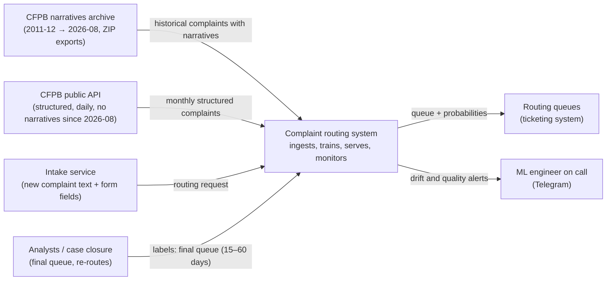
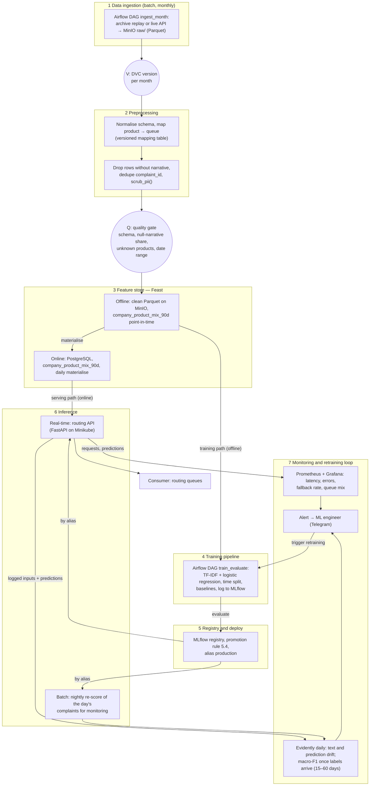
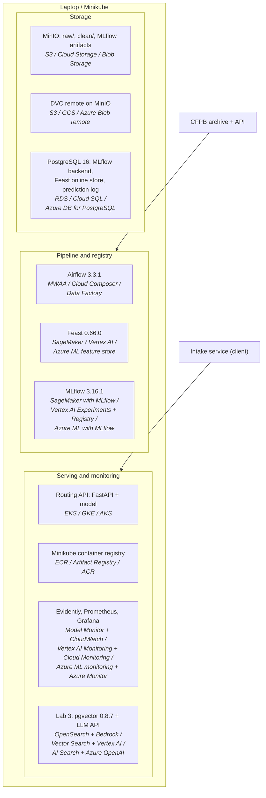

# Complaint routing — design document

> Status: Lab 1 draft. Statements marked **Assumption** are decisions taken without data yet; later labs confirm or revise them.
> Section numbers follow the [ml-design-docs](https://github.com/eugeneyan/ml-design-docs) template and must not change.

## 1 Overview

A consumer-finance complaint intake service receives free-text complaints and has to send each one to the right product review queue (credit reporting, debt collection, mortgage, …). Today routing is manual or depends on the product the consumer picks, which is often wrong; misrouted complaints wait in the wrong queue and miss the 15-day response deadline. We build a system that classifies each complaint narrative into a routing queue at intake, learns from monthly batches of newly closed complaints, and is monitored for drift in language, product mix and taxonomy. The desired outcome is fewer manual re-routes, and a model that keeps up with new products and taxonomy changes instead of decaying silently.

## 2 Motivation

- **Who consumes the predictions.** The intake service calls the model once per new complaint and puts the complaint into the predicted queue. Analysts in each queue work the complaint and re-route it by hand when it is wrong.
- **How often.** Online, one request per complaint at submission.
  - Our data source, the CFPB Consumer Complaint Database, reached about 490–620 k complaints per month in 2026, measured on the public API on 2026-10-19.
  - **Assumption:** our intake service handles a 5 % slice, ≈ 1,000 complaints per day.
  - The model is retrained monthly.
- **What happens when it is wrong.**
  - The complaint sits in the wrong queue until an analyst notices, then is re-routed. Every re-route costs analyst time and eats into the company's 15-day response window.
  - Errors are not uniform. A rare product (student loans, virtual currency) sent to the huge credit-reporting queue can wait for days.
- **Why a notebook is not enough.** The data moves:
  - The product taxonomy changed in 2017 and again in 2023–2024. The API shows *Credit reporting* → *Credit reporting, credit repair services, …* → *Credit reporting or other personal consumer reports*, and *Credit card or prepaid card* → *Credit card*.
  - The product mix shifted: credit reporting grew from about 20 % of complaints in 2015 to about 90 % in 2026.
  - On 2026-08-14 the source stopped publishing narratives altogether (see 5.2).

  A model trained once is wrong about all three, and only a system with versioned data, time-based validation and monitoring notices.

## 3 Success metrics

| Layer | Metric | Target | Type |
|---|---|---|---|
| Business | Manual re-route rate: share of complaints an analyst moves to another queue | ≤ 10 % (**Assumption**: the current manual baseline is unknown; measured from labels once the system runs) | optimizing |
| Business | Complaints that miss the 15-day response window because of misrouting | not higher than before the model (**Assumption**) | satisficing |
| Model | Macro-F1 over routing queues on the held-out months | maximize; must beat the production model and the majority-class baseline | optimizing |
| Model | Recall per queue | ≥ 0.60 for every queue, so small queues are not sacrificed to credit reporting | satisficing |
| System | Prediction latency p95 at the model service | ≤ 300 ms per complaint | satisficing |
| System | Availability of the model service | 99.5 % monthly; on failure, complaints go to a general triage queue | satisficing |
| System | Model freshness | a model trained on data no older than 2 months is in production | satisficing |

Accuracy is deliberately not a target. Among all complaints, credit reporting is 91 % (May 2026), so a model that always says "credit reporting" reaches 0.91 accuracy on that population and is useless for routing. Among complaints with a narrative, the largest queue is only 33 % (5.2), so accuracy also changes meaning with the population. Macro-F1 does not.

## 4 Requirements and constraints

### Functional

- **F1. Ingest** a monthly batch of complaints:
  - historical text from the CFPB narratives archive, replayed month by month;
  - structured records from the live CFPB API.
- **F2. Version** each raw batch and each built dataset, so any model traces back to its exact rows.
- **F3. Validate** each batch with a quality gate before it is used:
  - schema check;
  - share of null narratives;
  - unknown product names;
  - date range;
  - duplicate complaint ids;
  - narrative length below 50 characters, and duplicate narrative text (pasted boilerplate).
- **F4. Map products to routing queues** with a versioned mapping table. The table absorbs taxonomy renames, so old and new product names land in the same queue.
- **F5. Train** a candidate on all months up to *t*, evaluate it on held-out months, and log parameters, metrics, data version and commit to MLflow.
- **F6. Register** the candidate with lineage. Promotion needs a passing comparison and a human approval.
- **F7. Serve** an HTTP endpoint:
  - input: `{complaint_id, narrative, company, state, submitted_via, tags}`;
  - output: `{queue, probabilities, model_version}`.
- **F8. Monitor** inputs, predictions and service health. When labels arrive, monitor quality too. Alert a human when a threshold is crossed.

### Non-functional (one row per category)

| Category | Requirement |
|---|---|
| Freshness | A new monthly batch is ingested, validated and available for training within 24 h of the month closing. Company features in the online store are at most 24 h old. The production model is retrained monthly and is never older than 2 months. |
| Latency and throughput | p95 ≤ 300 ms per request. Sustained ≥ 5 requests/s on one CPU pod (**Assumption**: ≈ 1,000 complaints/day on average, so a 10× peak is about 0.1 req/s; the headroom is for batch re-scoring and load tests). |
| Availability and fallback | 99.5 % for the model service. If the model or the feature store is unavailable, the intake service sends the complaint to the general triage queue and logs the fallback. If a requested model version fails to load, the pod is not ready, and the previous version keeps serving. |
| Reproducibility | Any registered model can be rebuilt with one command from a git commit plus a DVC data version. The environment is pinned by `uv.lock`; random seeds are fixed. |
| Adaptability | A taxonomy rename is a change to the mapping table, not to code. A new product either maps to an existing queue or adds a queue with the next monthly retrain. The time from a new batch to a promoted model is ≤ 1 week. |
| Observability without ground truth | The label (the final queue) is known only when the complaint is closed, 15–60 days after submission (5.2). Until then we monitor proxies: predicted queue mix, confidence distribution, narrative length and vocabulary drift, null-narrative rate, and the fallback rate. |
| Cost and resource ceilings | Everything runs on one laptop (Minikube, 4 GB). Training must finish in ≤ 30 min on a laptop CPU (TF-IDF + linear model on a sampled dataset). Raw data in the lake must stay ≤ 10 GB (**Assumption**: years 2022–2026; the clean layer keeps only rows with a narrative, about 20 k per month in 2026). Cloud estimate in 6.7. |

### In scope

- Monthly ingestion, versioning and validation of complaint batches.
- The product-to-queue mapping.
- Training, evaluation and the registry.
- The online routing endpoint.
- Monitoring and the retraining loop.
- In Lab 3, the LLM complaint assistant (see 7.4).

### Out of scope

- Predicting issue or sub-issue.
- Drafting replies to consumers.
- Routing to a specific company (the consumer names it).
- The intake UI and the analysts' ticketing tool: we only define the contract with them.

## 5 Methodology

### 5.1 Problem statement

- **Framing.** Multi-class text classification: narrative plus a few structured fields → one routing queue out of about 10. Each complaint has exactly one product, so one label per complaint.
- **Rejected framing: classify the issue (≈ 80 classes) and derive the queue from it.** It gives finer routing, but most issues have few examples per month. Issue names also change with the taxonomy even more often than products. The extra granularity is not needed to pick a queue.

### 5.2 Data

**Sources**

- **CFPB Consumer Complaint Database Narratives Archive** (FOIA reading room). It holds complaints received between 2011-12-01 and 2026-08-14, as ZIP exports per month or multi-month period.
  - Recent files are 10–75 MB each, from HEAD requests on 2026-10-19.
  - **Verified on `CCDB_Export_21_August_2026.zip`** (2026-10-19): one CSV with the classic export schema, 16 columns:
    - `Date received`, `Product`, `Sub-product`, `Issue`, `Sub-issue`;
    - `Consumer complaint narrative`, `Company public response`;
    - `Company`, `State`, `ZIP code`, `Tags`, `Submitted via`;
    - `Date sent to company`, `Company response to consumer`, `Timely response?`, `Complaint ID`.
    - There is no consent column.
  - **August 2026 contains 667,140 complaints but only 1 narrative.** The month is effectively text-free.
  - **Verified on `CCDB_Export_18_May_2026.zip`:**
    - May 2026 has 619,940 complaints, of which 17,528 (2.8 %) have a narrative.
    - The weekly count grows from 3,311 to 4,924 through the month.
    - The median narrative is 1,053 characters long; 77.9 % contain `XXXX` masks.
  - **Assumption:** June and July 2026 have a similar volume (checked in Lab 2). August does not (above).
  - This is the text source for training.
- **Live CFPB API** (`consumerfinance.gov/data-research/consumer-complaints/search/api/v1/`, CC0 licence).
  - Structured complaints, updated daily: 18.5 M records in total on 2026-10-19.
  - **Since 2026-08-14 it publishes no narratives.** The CFPB ended narrative publication; the structured fields are still published.
  - We use it to monitor the product mix after August 2026, and as a real case of an upstream schema change (6.6, 6.9).

**Arrival pattern.**
- Monthly batches, cut by `date_received`.
- Until 2026-08 these come from the archive, **replayed on a simulated clock**: Lab 2's "next month" is the next archive month.
- After 2026-08 they come from the live API, structured fields only.
- The CFPB publishes a complaint after the company responds or after 15 days, whichever comes first, so a month is complete about 15 days after it ends.

**Labels and their delay.**
- The label is the routing queue, derived from `product` through the mapping table. The current taxonomy has 11 products, so there are 11 queues before mapping.
- In our intake scenario the final queue is known when the complaint is closed.
  - The company gives a first response within 15 days and closes the case within 60.
  - In the August 2026 file, exported on 2026-09-14 (2–6 weeks after receipt), 55.5 % of complaints were still "In progress".
  - **Labels therefore arrive 15–60 days after the prediction.** Most arrive within 60 days (**Assumption**, based on the 60-day closure rule).
- Routing itself is fast in the source: the median time from `Date received` to `Date sent to company` is 0 days, and the 99th percentile is 1 day.
- In the CFPB data the product is chosen by the consumer, so it is a noisy proxy for the true queue (see 6.9).

**Observed in August 2026** (all 667,140 rows):
- 92.9 % of complaints are credit reporting.
- The three credit bureaus (TransUnion, Experian, Equifax) account for 90.7 % of all complaints, out of 1,588 companies.
- 99.6 % are submitted via the web.
- 2.1 % carry a tag (Servicemember, Older American).

**The text data is a very different population** (May 2026, the 17,528 complaints with a narrative):

| Queue | All complaints | With narrative |
|---|---|---|
| Credit reporting | 91.1 % | 4.3 % |
| Debt collection | | 32.7 % |
| Checking or savings account | | 17.4 % |
| Credit card | | 17.3 % |
| Money transfer, virtual currency | | 8.2 % |
| Mortgage | | 6.5 % |
| 5 other queues | | 13.7 % |

Credit-reporting complaints almost never carry a published narrative. The model is therefore trained on a population where credit reporting is a small class, while an intake service would see it as the overwhelming majority. This selection bias is handled in 5.4 and 6.9.

Some narratives are not complaints at all; for example, a pasted chatbot conversation. This is why the quality gate checks length and duplicate text.

**Available at serving vs training time.**

| Field | Training | Serving | Use |
|---|---|---|---|
| Narrative text | yes, PII already scrubbed by CFPB (`XXXX`) | yes, raw text with PII | model input after the same scrubbing step |
| Company, state, submitted via, tags | yes | yes, entered at intake | model inputs |
| Company product mix over the last 90 days | computed point-in-time from history | online feature store | model input |
| Product, sub-product, issue, sub-issue | yes | **no**: the label and its children | label only; never features (leakage) |
| Company response, timely, dates sent or closed | yes | **no**: they happen after routing | label delay and monitoring only |

**Checklist justification**

| Item | Justification |
|---|---|
| Time axis | Every complaint has `date_received`. Monthly batches come from the archive (2011-12 → 2026-08) and the live API (2026-08 → now), so ingestion can literally take "the next month". |
| History to hold out | We use 2022-01 → 2026-07, 55 months, which includes the 2023–2024 taxonomy changes. The split: train on 2022-01 → 2026-02, validate on 2026-03 → 2026-04, test on 2026-05 → 2026-07. May 2026 alone has 17,528 narratives (verified), so the test window is large enough. 2026-08 has 1 narrative in 667,140 rows (verified), so it is not used for text; it is kept for the Lab 4 schema-change demo. **Plan if May–July 2026 are also thin on text:** move the test window back to the last 3 months that each have ≥ 5,000 narratives, and shift validation with it. |
| Labels with known delay | The label is the final queue, known when the complaint closes, 15–60 days after submission (55.5 % of August 2026 complaints were still open after 2–6 weeks). Monitoring therefore uses proxies until complaints close, and real macro-F1 afterwards (6.6). |
| Text surface / corpus | The narratives themselves are the text task. For Lab 3 retrieval, the corpus is CFPB public documents: product and issue definitions, consumer guides (Ask CFPB), and regulation summaries (FCRA, FDCPA, Reg E, Reg Z). Past narratives are the "similar complaints" index. |

### 5.3 Techniques

- **Baseline 1 (trivial).** Always predict the majority queue of the training data (debt collection on narrative data). On May 2026 narratives that gives accuracy 0.33 and macro-F1 ≈ 0.04 (one queue out of 11 with F1 ≈ 0.49). This sets the floor.
- **Baseline 2 (rules).** Keyword rules per queue ("mortgage", "escrow" → mortgage; "collector", "owe" → debt collection; …), with fallback to the majority queue. This is the "would a rule do?" check.
- **Candidate.** TF-IDF (word 1–2-grams) on the scrubbed narrative + one-hot company, state, channel and tags + company product-mix features → logistic regression with class weights.
  - It is cheap to train on CPU and fast to serve, and the coefficients are explainable.
  - A fine-tuned small transformer (DistilBERT-class) is a later alternative, used only if the linear model misses the per-queue recall target.

**Features and their serving-time source.**

| Feature | Training-time source | Serving-time source |
|---|---|---|
| Narrative TF-IDF | archive narrative, already scrubbed by CFPB | raw intake text → **our** `scrub_pii()` → same versioned vectorizer |
| Narrative length, `XXXX` share | archive narrative | computed by the same code from the request |
| Company (top-N one-hot, rest "other") | archive `company` | intake form field |
| State, submitted via, tags | archive fields | intake form fields |
| `company_product_mix_90d` (share of each queue in the company's last 90 days) | Feast offline store, point-in-time join on `date_received` | Feast online store, refreshed daily |

Two fields carry less signal than they seem:
- `Submitted via` is 99.6 % web. It is kept because it costs nothing, but it barely helps.
- `Company` nearly decides credit reporting on its own: the three bureaus account for 90.7 % of complaints. The text matters for everything else.

Two features have a serving-time source that differs from the training-time source:
- **Narrative.** CFPB scrubbed the training text with its own tool, while serving text is raw and goes through our `scrub_pii()`. If the two scrubbers differ, the text differs.
- **Company product mix.** Training uses an exact point-in-time join; serving uses yesterday's snapshot.

### 5.4 Experimentation and validation

- **Split by time.**
  - Train on 2022-01 → 2026-02, validate on 2026-03 → 2026-04, test on 2026-05 → 2026-07.
  - A random split would mix months before and after a taxonomy change, and complaints from one company campaign, into both sides. It would also let the 90-day company feature see the future, so the score would overstate what the model does next month.
  - For monthly retrains we use a rolling window: train on everything up to *t−1*, test on month *t*.
- **Population check.** The test months contain only complaints with a narrative, where credit reporting is 4 %. Besides the plain test score, we report accuracy re-weighted to the full product mix of the same months (from the structured data, where credit reporting is 91 %). That is the estimate of what an intake service would see.
- **Offline metric.** Macro-F1 over queues (optimizing), with per-queue recall ≥ 0.60 (satisficing). We also report a confusion matrix and the per-queue support.
- **New vs current model.** Both are scored on the same latest held-out month(s). The candidate is promoted only if:
  - macro-F1 ≥ production + 0.01;
  - no queue's recall drops by more than 5 pp;
  - every queue's recall stays ≥ 0.60;
  - p95 latency in the service load test stays ≤ 300 ms.

### 5.5 Human in the loop

- **Drift alert.** The ML engineer on call (the project owner) receives it in Telegram, opens the Evidently report and the Grafana dashboard, and decides: ignore, fix the mapping table, or retrain early.
- **Model promotion.** The pipeline registers a candidate with its comparison report. The ML engineer moves the `production` alias in MLflow by hand after reading it. **Assumption:** in a real intake team, the queue lead also signs off when a queue is added or removed.
- **Override.**
  - Analysts re-route any complaint by hand; every re-route is logged and becomes a label.
  - The ML engineer can roll back the alias to the previous version or switch the service to the fallback (general triage) with a config flag.
- **Taxonomy change.** A new product name fails the quality gate as "unknown product". A human adds it to the mapping table; that is a versioned change reviewed in a pull request.

## 6 Implementation

### 6.1 High-level design

#### System context

#### Data flow (seven layers)

The three marks are drawn as circles:
- **V**, the version point after ingestion;
- **Q**, the quality gate before the feature store;
- **the split** between the offline side (training) and the online side (serving), inside layer 3.

The narrative is not stored in the feature store: it arrives with the request. The vectorizer and `scrub_pii()` ship inside the registered model, so the training and serving paths run the same code on the text.

#### Deployment (first draft; Lab 4 replaces it)

Each box names the local component and, in italics, its managed equivalent on AWS / GCP / Azure.

### 6.2 Infra

| Component | Local (pinned) | AWS | GCP | Azure |
|---|---|---|---|---|
| Object storage, data lake | MinIO-compatible `pgsty/silo` | Amazon S3 | Cloud Storage | Blob Storage |
| Data versioning remote | DVC 3.67.1 + dvc-s3 3.3.0 on MinIO | S3 remote | GCS remote | Azure Blob remote |
| Warehouse / serving DB | PostgreSQL 16 | Amazon RDS | Cloud SQL | Azure Database for PostgreSQL |
| Orchestrator | Apache Airflow 3.3.1, LocalExecutor | Amazon MWAA | Cloud Composer | Azure Data Factory |
| Experiment tracking, registry | MLflow 3.16.1 (PostgreSQL backend, MinIO artifacts) | SageMaker with MLflow | Vertex AI Experiments + Model Registry | Azure ML with MLflow |
| Feature store | Feast 0.66.0 (offline: Parquet on MinIO; online: PostgreSQL) | SageMaker Feature Store | Vertex AI Feature Store | Azure ML managed feature store |
| Container registry | Minikube built-in registry | Amazon ECR | Artifact Registry | Azure Container Registry |
| Kubernetes cluster | Minikube 1.33.1 (K8s 1.30.0, docker driver, 4 GB) | Amazon EKS | GKE | AKS |
| Model and data monitoring | Evidently | SageMaker Model Monitor | Vertex AI Model Monitoring | Azure ML model monitoring |
| Metrics and dashboards | Prometheus, Grafana | Amazon CloudWatch | Cloud Monitoring | Azure Monitor |
| Vector store, LLM (Lab 3) | pgvector 0.8.7 / LLM API | OpenSearch Serverless / Amazon Bedrock | Vertex AI Vector Search / generative AI | Azure AI Search / Azure OpenAI |

### 6.3 Performance

- **Online, not batch.**
  - A complaint should land in a queue at submission. Batch routing (for example hourly) would add up to an hour of the 15-day budget to every complaint, for no saving: the model is a linear classifier and a request costs milliseconds.
  - A nightly batch re-score exists only for monitoring.
- **Budgets.**
  - Throughput: ≈ 1,000 complaints/day (**Assumption**), about 0.01 req/s on average and ~0.1 req/s at peak. We design for ≥ 5 req/s on one CPU pod.
  - p95 ≤ 300 ms end to end, of which ≤ 50 ms is the Feast online lookup (**Assumption**, measured in Lab 4).
- **Training.** Batch, monthly, ≤ 30 min on a laptop CPU.

### 6.4 Security

- **Secrets** (MinIO keys, PostgreSQL password, Telegram bot token, the LLM API key in Lab 3):
  - locally, an untracked `.env`;
  - on Minikube, Kubernetes Secrets;
  - in the cloud, AWS Secrets Manager or its equivalent.
  - Nothing secret is committed.
- **Who may call.** Only the intake service may call the routing API, with a service token; the API is not exposed outside the cluster. MLflow, Airflow and Grafana are available on localhost only.

### 6.5 Data privacy

- **Training data.** The training data is public (CC0). Narratives are scrubbed of PII by the CFPB (`XXXX`), but they still describe personal financial situations. ZIP codes are truncated in the source, and tags such as "Older American" or "Servicemember" are sensitive attributes.
- **Serving data.** Serving requests in the intake scenario contain raw PII (names, account numbers). `scrub_pii()` runs before anything is logged; the prediction log stores only scrubbed text.
- **Retention.**
  - Raw batches: as long as a registered model depends on them (lineage).
  - Prediction logs: 90 days.
  - Raw request bodies are never stored.
- **Sensitive attributes.** Tags are used as features. **Assumption:** this is acceptable for routing, but recall per tag group is reported, so the model does not route vulnerable groups worse.

### 6.6 Monitoring and alarms (first draft; Lab 4 makes it real)

| Metric | Where computed | Threshold (**Assumption**) | Who is alerted |
|---|---|---|---|
| Latency p95, error rate, fallback rate | Prometheus, from the API | p95 > 300 ms or errors > 1 % or fallback > 2 % for 10 min | ML engineer (Telegram) |
| Predicted queue mix vs the training reference | Evidently, daily | Jensen–Shannon distance > 0.1 | ML engineer |
| Text drift: narrative length, vocabulary (share of out-of-vocabulary tokens) | Evidently, daily | OOV share > 1.5 × reference, or a length-distribution drift test fails | ML engineer |
| Confidence: share of predictions with max probability < 0.5 | Evidently, daily | > 2 × reference | ML engineer |
| Macro-F1 and per-queue recall on labelled complaints | Airflow eval task, weekly, on complaints closed in the past week (received 15–60 days earlier) | macro-F1 drops > 0.05 vs test, or any queue recall < 0.60 | ML engineer → retraining decision |
| Upstream schema and freshness: null-narrative share, unknown products, rows per batch | Quality gate in `ingest_month` | null narratives > 5 %, any unknown product, or a row count equal to the previous run (stale partition) | ML engineer; the DAG fails |

The 2026-08-14 narrative cutoff is exactly the event the last row exists for: the null-narrative share of the live API batch jumps to 100 %. The gate stops the batch from reaching training, and the monitoring falls back to queue-mix tracking on structured data.

### 6.7 Cost

**Estimated monthly cost on AWS, eu-central-1 (Frankfurt), built in the AWS Pricing Calculator on 2026-10-19.**

- **Shared estimate (managed column):** <https://calculator.aws/#/estimate?id=b0b3764d03292766da21638047a9bb0df5cafd35>
- **Unit prices** were cross-checked against the AWS Price List API.
- **Not included:** the free tier, data transfer and taxes.
- **Two calculator conventions** behind some numbers:
  - MWAA's smallest option is the *Small* environment (the price list also has a cheaper *micro*, but the calculator does not offer it);
  - the MLflow tracking server is billed for 30 days × 24 h = 720 h.

Two columns:
- **Managed** costs the services named in 6.2, as the template asks.
- **Lean** keeps the same architecture but runs Airflow and MLflow as pods on the EKS node instead of their managed versions. It is computed with the same unit prices and is not part of the shared link.

| Item | Sizing (**Assumption**) | Unit price | Managed, USD | Lean, USD |
|---|---|---|---|---|
| MWAA | Small environment, 1 worker, always on; 1 GB metadata | $0.49 / h + $0.10 / GB-month | 357.80 | — (pod on EKS) |
| SageMaker with MLflow | 1 small tracking server, 24 × 30 h; 1 GB | $0.886 / h + $0.119 / GB-month | 638.04 | — (pod on EKS) |
| EKS | 1 cluster, standard support | $0.10 / h | 73.00 | 73.00 |
| EC2 node for EKS | t3.medium managed / t3.large lean, + 20 GB EBS | $0.048 or $0.096 / h + $0.0952 / GB-month | 36.94 | 71.98 |
| RDS PostgreSQL | db.t4g.micro single-AZ + 20 GB gp3 | $0.019 / h + $0.137 / GB-month | 16.61 | 16.61 |
| CloudWatch | 20 metrics, 5 alarms, 2 GB logs | $0.30 / metric, $0.10 / alarm, $0.63 / GB | 7.77 | 7.77 |
| SageMaker Model Monitor | 30 processing jobs × 15 min, ml.m5.large | $0.138 / h | 1.03 | 1.03 |
| S3 | 20 GB Standard | $0.0245 / GB-month | 0.49 | 0.49 |
| ECR | 1 GB of images | $0.10 / GB-month | 0.10 | 0.10 |
| SageMaker Feature Store | 0.05 M writes + 0.03 M reads, 0.01 GB | $1.525 / M writes, $0.305 / M reads | 0.09 | 0.09 |
| SageMaker training | 1 job × 30 min, ml.m5.large | $0.138 / h | 0.07 | 0.07 |
| **Subtotal (calculator)** | | | **1,131.95** | **171.14** |
| LLM API (Lab 3) | ≈ 50 k tokens/day; not priced until the model is chosen | | 10 | 10 |
| **Total** | | | **≈ 1,142** | **≈ 181** |

**What the numbers say**
- The two always-on managed control planes are 88 % of the managed bill: the MLflow tracking server is $638 and MWAA is $358. Yet the workload is one training run and a few DAG runs per month.
- The model itself costs cents: training is $0.07 per month, and serving fits on the shared node.
- The decision is therefore the lean column: the same components, self-hosted on the cluster we already pay for. The managed versions are worth it only when the team, not the workload, grows (more users, SLAs on the tracking server).

### 6.8 Integration points

- **Upstream: CFPB (archive and API).**
  - Contract: archive ZIP exports in the classic database schema. API JSON documents with `complaint_id`, `date_received`, `product`, `company`, … as of 2026-10-19.
  - No contract with the CFPB is possible: schema changes are detected by the quality gate.
- **Upstream: case closure (labels).**
  - Contract: `{complaint_id, final_queue, closed_at}`, delivered daily.
  - **Assumption:** in the replayed data, `final_queue` is the mapped `product`, available 60 days after `date_received` (the conservative end of the observed delay).
- **Downstream: intake service.**
  - Contract: `POST /route` with `{complaint_id, narrative, company, state, submitted_via, tags}` returns `{queue, probabilities, model_version}` within 300 ms.
  - On a 5xx or a timeout, the client uses the general triage queue.
  - The queue list is versioned with the mapping table; a new queue is announced before the model that predicts it is promoted.

### 6.9 Risks and uncertainties

| Risk | Mitigation |
|---|---|
| No new narratives after 2026-08-14, so the text model cannot be retrained on fresh text | Replay the archive for Labs 2–4. After 2026-08, monitor queue mix on structured data, and say so. A real deployment would collect its own intake text. |
| Labels are noisy: the product is chosen by the consumer, not confirmed | Treat the label as a proxy. Analyst re-routes are the real labels in production. Measure label noise on a hand-checked sample of 200 complaints. |
| Class imbalance: the largest queue with narratives is 33 % and the smallest is 0.9 % | Macro-F1 and per-queue recall as metrics, class weights |
| Selection bias: the training data (complaints with a published narrative) has 4 % credit reporting, while the intake population has 91 % | Report metrics per queue, not pooled. Re-weight the test set to the live product mix from the API (structured, still published) to estimate production accuracy. Optionally adjust predicted priors to that mix. |
| Taxonomy changes break the mapping | Versioned mapping table plus the "unknown product" gate check |
| Training–serving skew in PII scrubbing (CFPB's scrubber vs our `scrub_pii()`) | Run `scrub_pii()` on archive text as well, so both paths see the same masks; a test compares the `XXXX` share across paths |
| Leakage through issue or sub-product fields, or through future company stats | Fields are whitelisted per the table in 5.2; Feast point-in-time joins |
| Archive schema differs from the assumption | Checked on the first file in Lab 2; the schema normaliser in layer 2 absorbs it |

## 7 Appendix

### 7.1 Alternatives

| Alternative | Pros | Cons | Decision |
|---|---|---|---|
| Issue-level classification (≈ 80 classes) | Finer routing | Sparse classes; even less stable taxonomy | Rejected (5.1) |
| Fine-tuned transformer from the start | Likely higher macro-F1 | GPU for training, slower serving, harder to explain; quality is not graded | Deferred: only if the linear model misses the recall target |
| News classification on the HuffPost dataset | Simple, small | Frozen in 2022, most data before 2018, labels known immediately (weak monitoring story) | Rejected as the use case |
| Random train/test split | More test data, simple | Leaks across taxonomy changes and through company features | Rejected (5.4) |
| Batch routing (hourly) | Simpler serving | Adds delay to every complaint for no cost saving | Rejected (6.3) |

### 7.2 Experiment results

Placeholder: filled in Lab 2 (baselines vs candidate on the held-out months, from MLflow).

### 7.3 Performance benchmarks

Placeholder: filled in Lab 4 (routing API p50/p95 under load, Feast lookup latency).

### 7.4 Milestones

- **Lab 2.** Airflow ingests the archive month by month into MinIO with DVC versions and the quality gate. The time split, baselines and the candidate are tracked and registered in MLflow with data version and commit.
- **Lab 3.** An LLM complaint assistant retrieves similar past complaints and the relevant CFPB product and regulation documents, explains the routing decision with citations, and is evaluated on a fixed question set for retrieval and answer quality.
- **Lab 4.** The routing API and monitoring run on Minikube. Replaying 2026-08, or an injected shift in queue mix and vocabulary, crosses a drift threshold, and the alert reaches the ML engineer.
- **Lab 5.** An agent uses the system's tools (routing API, monitoring metrics, MLflow, the assistant) to triage a batch of complaints and explain a drift alert.
